<div align="center">


# Rheadric Lumen v2.1.1-alpha

**All the lighting and fans in your PC, from one window.**

Graphics card, keyboard, mouse, motherboard and RAM lighting · GPU fans, CPU fan, pump and case fans ·
live sensors and an FPS overlay on top of your game. One small native app instead of a stack of vendor tools.

**English** · [Türkçe](#turkce)

<a href="https://github.com/rheadricc/RheadricLumen/releases/download/v2.1.1-alpha/Rheadric-Lumen-v2.1.1-alpha-setup.exe"></a>


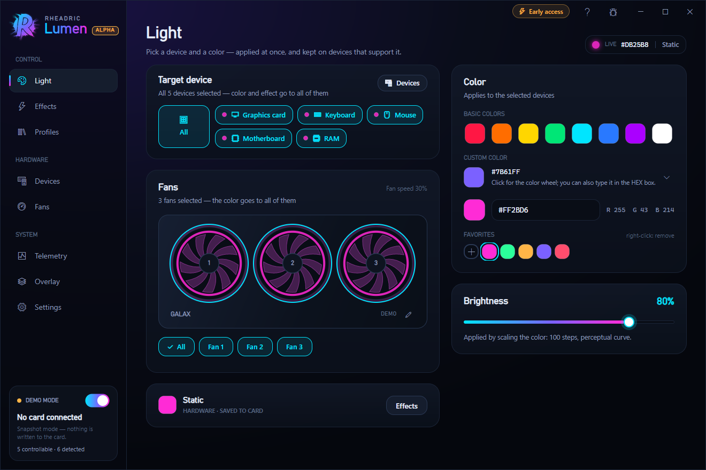

</div>

<a name="english"></a>

## Contents

[Download](#download) · [Requirements](#requirements) · [What it does](#what-it-does) · [Screenshots](#screenshots) ·
[Supported hardware](#supported-hardware) · [How to use it](#how-to-use-it) · [Command line](#command-line) ·
[Uninstall](#uninstall) · [FAQ](#faq) · [Privacy](#privacy) · [License](#license)

---

## Download

**Recommended: the setup.** The green **Download** button above gives
[`Rheadric-Lumen-v2.1.1-alpha-setup.exe`](https://github.com/rheadricc/RheadricLumen/releases/download/v2.1.1-alpha/Rheadric-Lumen-v2.1.1-alpha-setup.exe).
Run it and click through: it installs for your Windows user only (no admin prompt) into
`%LOCALAPPDATA%\Programs\Rheadric Lumen`, adds a Start menu entry, offers a desktop shortcut on its last page and puts
an uninstaller under *Settings → Apps*.

**Portable, without installing:** the program is also right here in this repository, `RheadricLumen.exe` plus the three
DLLs next to it (the renderer: `libSkiaSharp.dll`, `libHarfBuzzSharp.dll`, `av_libglesv2.dll`). Get them as
[`Rheadric-Lumen-v2.1.1-alpha-win64.zip`](https://github.com/rheadricc/RheadricLumen/releases/download/v2.1.1-alpha/Rheadric-Lumen-v2.1.1-alpha-win64.zip) (~17.0 MB)
or with the green **`<> Code`** button at the top of this page → **Download ZIP**. **Extract it** (right-click →
*Extract All…*), move the **Rheadric Lumen** folder somewhere permanent and double-click `RheadricLumen.exe`. Keep the
four files together.

Both are the same program and update themselves the same way. Older versions and release notes:
[Releases](https://github.com/rheadricc/RheadricLumen/releases).

> **Windows SmartScreen warning?** The exe is not digitally signed yet, so Windows shows
> *"Windows protected your PC"* on first run. Click **More info → Run anyway**.

> **Updating?** From 2.0.3 on the app does it itself: once a day it looks for a new release here, and a green
> **download button** shows up at the top right when there is one. One click downloads it, checks it and restarts the
> app as the new version (**Settings → Updates → Check for updates** looks right away). From an older version, quit
> it (tray icon → **Exit**) and start the new one: colors, profiles, favorites, fan settings and "Start with Windows"
> are carried over. Coming from 2.0.0 or older, the interface stays in Turkish; switch it in **Settings → Language**.

---

## Requirements

| | |
|---|---|
| **Windows 10 or 11, 64-bit** | Required. |
| **Nothing else for the app itself** | No installer, no .NET runtime, no Visual C++ redistributable: it's a native Windows program. |
| **NVIDIA graphics driver** | For the graphics card's lighting, GPU fans and GPU readings. Any recent GeForce driver. |
| **[PawnIO](https://pawnio.eu)** *(free, signed driver, optional)* | Only for **RAM lighting**, **motherboard fans** and **CPU / RAM temperatures**. On PCs that need it the app offers to install it on first start (or **Settings → PawnIO driver**): it downloads the official installer from its author's GitHub and checks it first. By hand: [PawnIO_setup.exe](https://github.com/namazso/PawnIO.Setup/releases/latest). It's the same driver OpenRGB and LibreHardwareMonitor use. |
| **SteelSeries GG** *(optional)* | Only for SteelSeries mouse lighting; it must be running. |
| **Razer Synapse** *(optional)* | Only for Razer lighting (its Chroma part); it must be running. |

Windows asks for **administrator permission** only when a feature needs it: GPU fan modes other than Auto,
and the hardware helper (RAM lighting, motherboard fans, CPU/RAM temperatures, FPS). On PCs that use them the app
asks **once**, a few seconds after its first start (and once more after an update), and then never again: it
registers a scheduled task that starts its helpers without a prompt (**Settings → Admin permission**, where it can
also be removed). Declined, Windows asks whenever a helper starts. Lighting, profiles, effects and the overlay work
without it.

---

## What it does

Each part of your PC usually comes with its own app: the graphics card with one, the keyboard with another, the
motherboard with a third, and the fans with their BIOS. Rheadric Lumen talks to the hardware directly and puts it all
in one window: pick the devices, pick a color or an effect, set the fans, and keep an eye on the sensors in game.

### Lighting

| | |
|---|---|
| 🎨 **Every device at once** | Graphics card, keyboard, mouse, motherboard and RAM: color one, several or **All**. Each device keeps its own setting, and a newly found device is never touched until you give it a color |
| 🌈 **Colors** | Color wheel, HEX input, 8 base colors, a custom slot and favorites. Brightness 0–100 |
| ✨ **Effects** | **Software effects** run on every selected device: Spectrum, Pulse, Fire, Aurora, Thermal, Sensor and Music (reacts to what you hear). Thermal and Sensor follow a reading you pick (GPU, CPU or RAM, temperature or load) over a range you set. **Hardware effects** (Static, Breathing, Rainbow, Color cycle, Motherboard sync, Off) run on the graphics card itself and stay after a reboot, even with the app closed |
| 💾 **Profiles** | 6 ready-made looks; save, overwrite and delete your own |

### Fans

| | |
|---|---|
| 🌀 **Graphics card fans** | Auto (driver), Fixed % or a drag-to-edit temperature curve, with live RPM. **0 dB**: below a temperature you set the fans are handed back to the driver, the only one that can stop them |
| 🌬️ **Motherboard fans** | CPU fan, pump and every system fan header, **each on its own**: Auto (BIOS), Fixed % or a curve that follows the CPU, the GPU or whichever is hotter. Copy one header's setting to all case fans; live RPM and board temperatures |
| 🛡️ **Safety first** | 100 % above GPU 85 °C / CPU 95 °C or if a temperature can't be read. Never below 20 % (case), 25 % (CPU fan) or 50 % (pump). A fan that reads 0 RPM for 5 s goes back to the BIOS. Every fan goes back to the driver / BIOS when you pick Auto, quit, or the app crashes |

### Sensors and overlay

| | |
|---|---|
| 📈 **Telemetry** | GPU temperature, load, power, fan, clocks and VRAM; CPU load and clock, RAM use. CPU (AMD Ryzen) and DDR5 temperatures, read only |
| 🖥️ **Sensor overlay** | A panel on top of your game and every window: pick from 15 readings; rows, columns or a horizontal / vertical strip; opacity, background, size. **Any monitor:** pick the screen on a map, use one of 8 fixed spots or **drag it** anywhere; it snaps to the margins and the middle. Clicks pass through it; temperatures turn amber / red near their limits. **Ctrl+Alt+O** shows and hides it |
| 🎮 **FPS** | Frame rate, 1 % low and frame time of the game in front, read from the same Windows events PresentMon uses. Add them to the sensor panel or show a separate **FPS panel** with its own spot and look |

### Everyday

| | |
|---|---|
| ⚡ **Quick control** | Tray menu with colors, effects, profiles and the overlay; **Ctrl+Alt+L** toggles every light from anywhere; optional start with Windows; [command line](#command-line) |
| 🌍 **English / Türkçe** | Starts in English; **Settings → Language** switches the whole interface at once, tray menu and overlay included |
| ⬇️ **Updates** | Looks for a new version once a day; the green button at the top right installs it in one click and your settings stay |
| 📦 **Move your settings** | **Settings → Move your settings → Export** puts colors, profiles, favorites, fan settings and the overlay in one file; **Import** on the new PC brings them back |
| 🐞 **Report a bug** | The bug icon at the top right sends what went wrong straight to the developer, with the hardware and recent logs if you want |
| 🔒 **Private** | No account, no ads. Anonymous diagnostics you can read first and turn off any time ([Privacy](#privacy)) |

---

## Screenshots

| Devices | Effects | Sensor effect (CPU load) | Profiles |
|---|---|---|---|
| 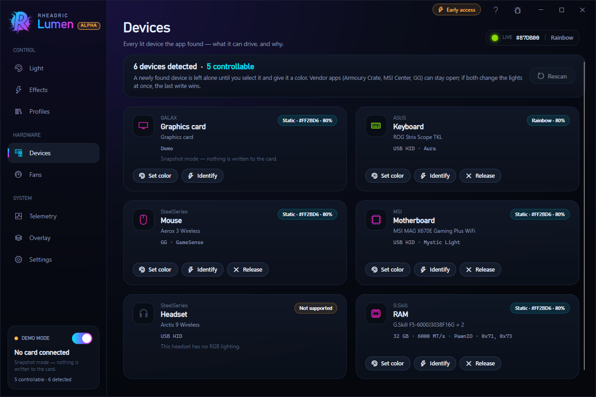 | 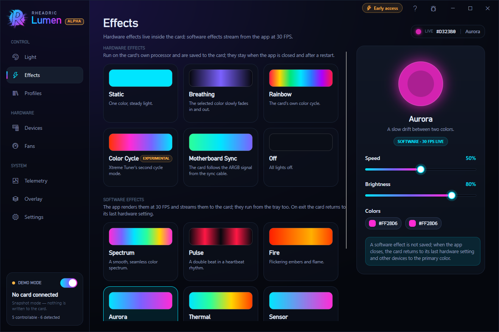 | 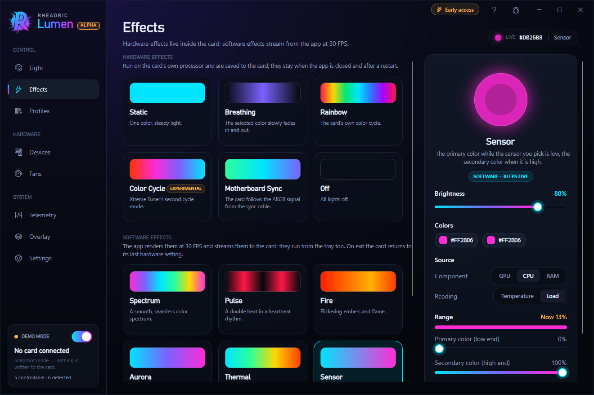 | 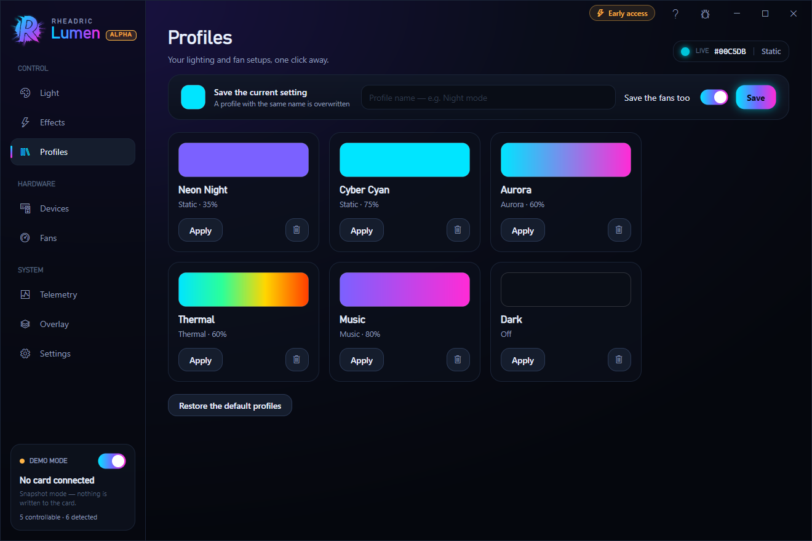 |

| Graphics card fan curve | 0 dB | Motherboard fans | Telemetry |
|---|---|---|---|
| 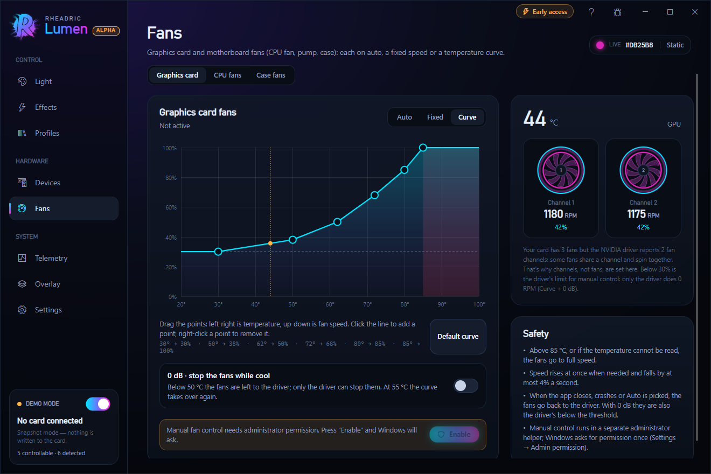 | 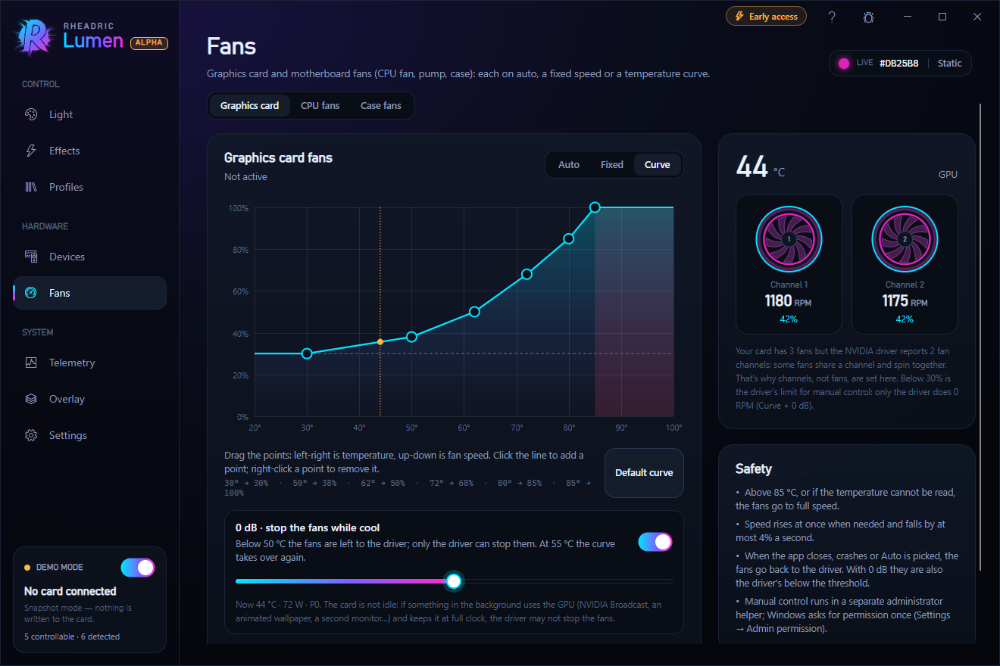 | 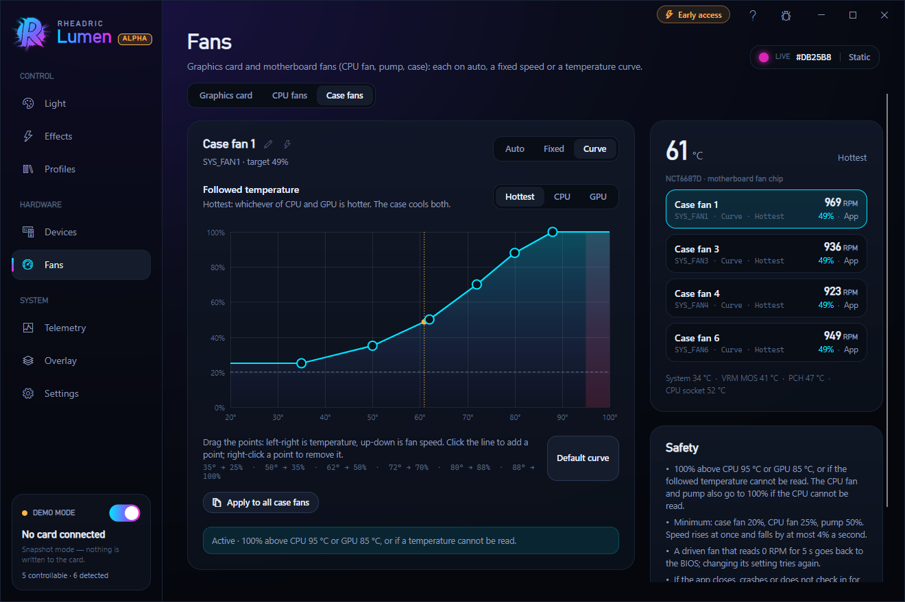 | 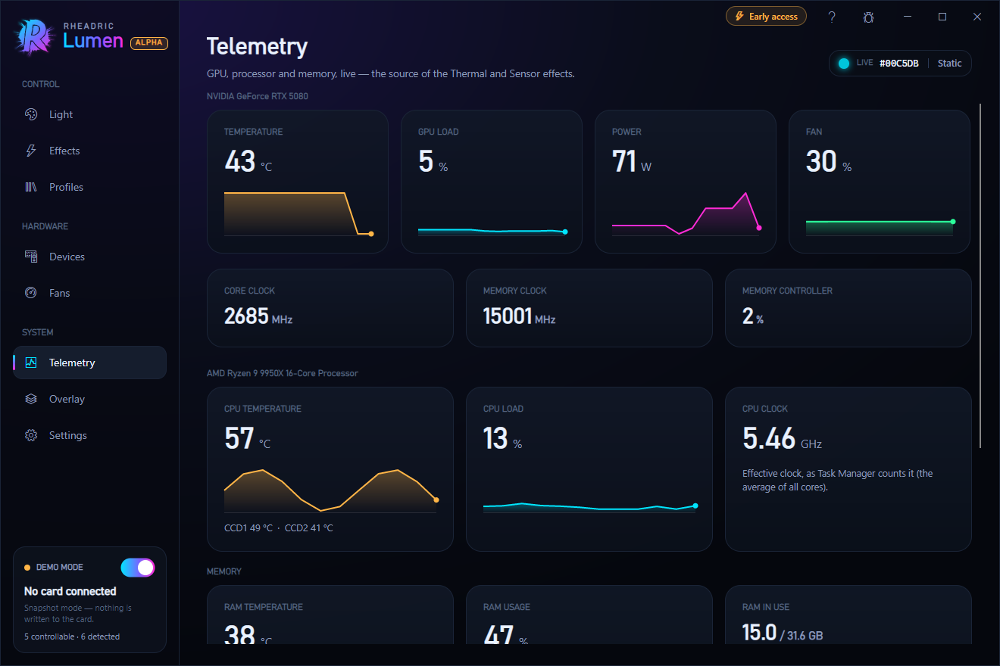 |

| Overlay settings | Placed freely on a side screen | On screen (strip, no background) | On screen (columns) |
|---|---|---|---|
| 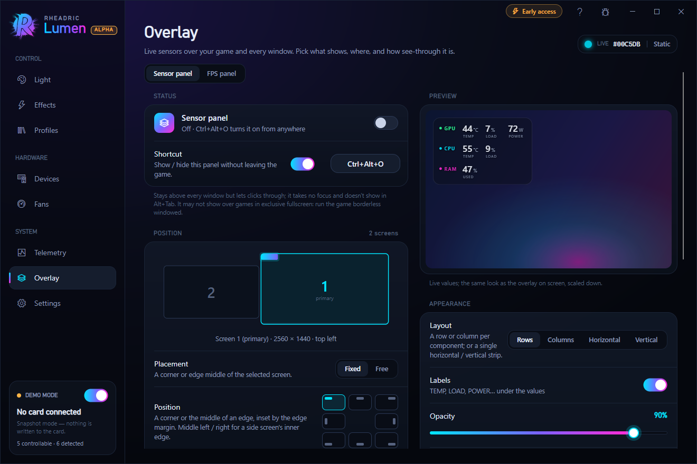 | 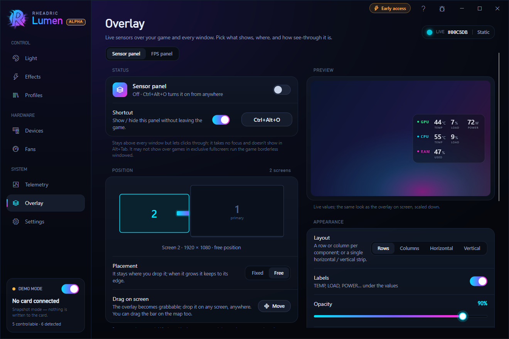 |  | 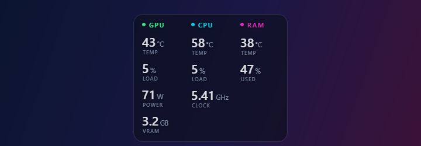 |

| FPS panel settings | FPS panel on screen | Vertical strip (with FPS) | Settings and language |
|---|---|---|---|
| 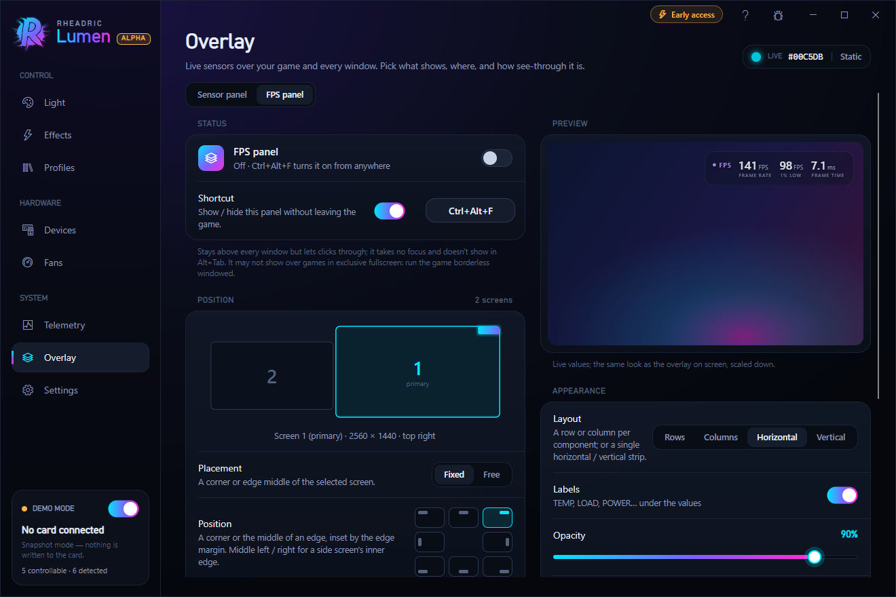 |  | 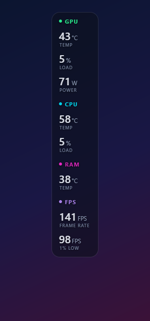 | 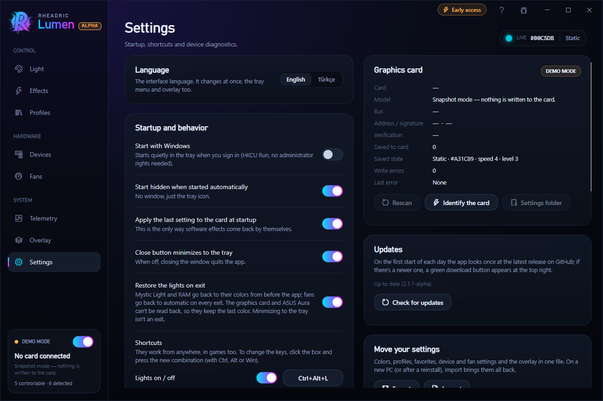 |

| A new version | PawnIO on first start |
|---|---|
| 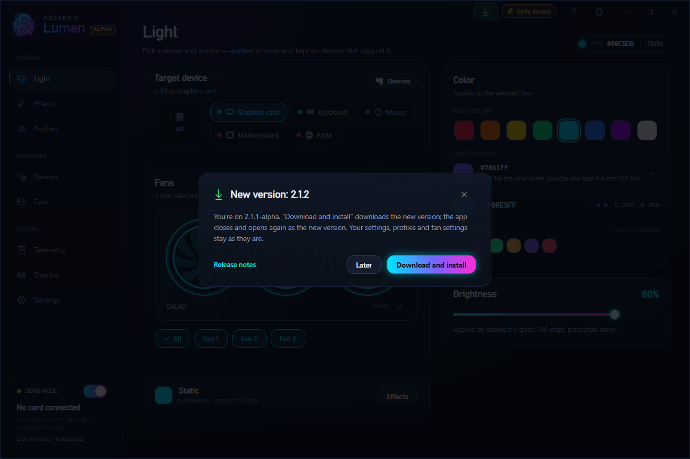 | 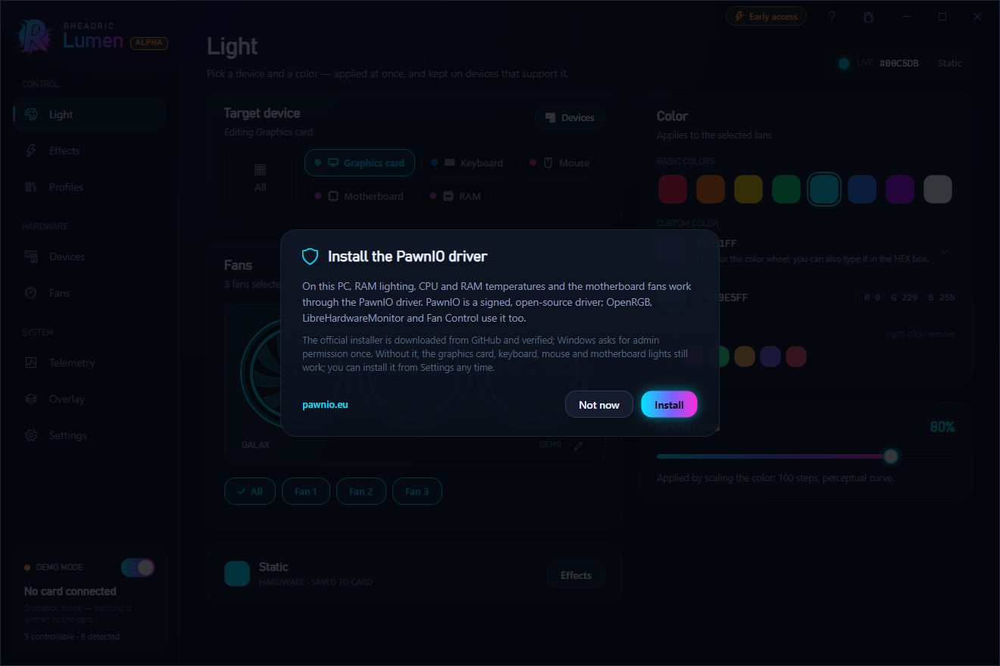 |

---

## Supported hardware

What's below has been tested on real hardware unless it says otherwise. Have something else?
[Open an issue](https://github.com/rheadricc/RheadricLumen/issues) with its exact model name, or press the bug icon at the top right of
the app: with *Include hardware details* on, the report already says what was found.

### Lighting

| Device | How | Notes |
|---|---|---|
| **GALAX GeForce RTX 5080** 1-Click OC 3X | NVIDIA driver (the card's RGB controller over I²C) | Tested. Replaces Xtreme Tuner for the lighting |
| **GALAX GeForce RTX 5070 Ti** EX Gamer 1-Click OC | same | Added from known IDs, not tested yet |
| **ASUS** graphics cards with an Aura controller (TUF, ROG Strix, ROG Astral, Dual…; the RTX 20–50 models OpenRGB lists) | same (I²C `0x67`) | Added from OpenRGB's protocol, not tested yet. All the card's lights in one color; a controller version it doesn't know is left alone |
| **MSI** graphics cards (Gaming X, Suprim, Ventus…; the RTX 20–50 models OpenRGB lists) | same (I²C `0x68`) | Added from OpenRGB's protocol, not tested yet. All the card's lights in one color |
| **Gigabyte / AORUS** graphics cards (Gaming OC, Eagle, Aero, AORUS Master…; GTX 10 to RTX 50) | same (I²C) | Added from OpenRGB's protocol, not tested yet. All the card's lights in one color |
| **Palit**, **Gainward** and some **PNY** XLR8 graphics cards (GameRock, JetStream, Phoenix, Phantom, Ghost…; GTX 10 to RTX 50) | same | Added from OpenRGB's protocol, not tested yet. All the card's lights in one color |
| **EVGA** graphics cards (FTW3, XC…; GTX 10, RTX 20 and RTX 30) | same | Added from OpenRGB's protocol, not tested yet. All the card's lights in one color |
| **ZOTAC GAMING** graphics cards (Twin Fan, Trinity, AMP, AMP Extreme…; RTX 20 to RTX 50) | same | Added from OpenRGB's protocol, not tested yet. All the card's lights in one color |
| **Colorful iGame** graphics cards (Advanced, Ultra, Vulcan, Neptune…; RTX 30 to RTX 50) | same | Added from OpenRGB's protocol, not tested yet. All the card's lights in one color |
| **GALAX / KFA2** RTX 20 and RTX 30 cards (the earlier controller), older **ASUS** cards (GTX 10 to RTX 30, the first Aura chip), **MANLI** RTX 4090 Gallardo | same | Added from OpenRGB's protocol, not tested yet. All the card's lights in one color |
| **NVIDIA Founders Edition** (RTX 20 to RTX 50), and other cards whose lighting the NVIDIA driver itself offers (some Palit, Gainward, PNY EPIC-X, MANLI) | NVIDIA driver (Illumination API) | Added from NVIDIA's public API, not tested yet. Static color or off; the card doesn't save it, so the app writes it again when it starts |
| **ASUS ROG Strix Scope TKL** keyboard | USB, Aura direct mode | Tested, keys and underglow. Nothing is saved to the keyboard permanently |
| **SteelSeries Aerox 3 Wireless** mouse | SteelSeries GG (GameSense) | Tested. **GG must be running**; the mouse returns to your GG setting when the app quits |
| Other **SteelSeries** keyboards (Apex), mice (Rival, Sensei, Prime, Aerox) and QcK Prism mousepads | SteelSeries GG (GameSense) | Not tested yet. **GG must be running** |
| **Logitech G** keyboards, mice, headsets, mousepads, speakers | Logitech G HUB (its LED SDK) | Not tested yet. **G HUB must be running**; every Logitech G device gets the same color and goes back to its G HUB lighting when the app lets go |
| **QMK/VIA** keyboards (Keychron Q, V, K Pro and Max series, most custom boards) | USB, VIA's raw HID | Added from QMK's VIA protocol, not tested yet. Per-key lights and underglow in one color, saved to the keyboard; needs VIA protocol 11 or later |
| Devices with **Windows Dynamic Lighting** (HID LampArray: keyboards, mice, cases, strips of many makers) | USB HID LampArray | Not tested yet. A device a row above already drives is left to that row. Turn off *Use Dynamic Lighting on my devices* in Windows Settings so the two don't fight |
| **MSI Mystic Light** motherboards (`0DB0:0076`, e.g. X670E Gaming Plus WiFi) | USB | Tested. JRGB, JARGB and onboard LEDs; nothing is saved to the board permanently |
| **MSI Mystic Light** on the 800 series (X870, B850, Z890…; the boards OpenRGB lists) | USB | Added from OpenRGB's protocol, not tested yet. JARGB 1–3 and the JAF (EZ Conn) header; the board's own effect comes back after a restart or when MSI Center opens |
| **ASUS Aura** motherboards (USB `0B05:1AA6`, `19AF`, `1939`, `18F3`, `1BED`; X570 and later) | USB | Added from OpenRGB's protocol, not tested yet. Onboard LEDs, AURA RGB and ARGB headers (the fans and strips on them) in one color; nothing is saved to the board |
| **Gigabyte RGB Fusion 2** motherboards (USB `048D:8297`, `5702`, `5711`, `8950`, `0414:A100`) | USB | Added from OpenRGB's protocol, not tested yet. Onboard LEDs and RGB/ARGB headers in one color; nothing is saved, the board's own setting comes back after a power cycle |
| **ASRock Polychrome** motherboards (USB `26CE:01A2`) | USB | Added from OpenRGB's protocol, not tested yet. Every zone the controller reports (RGB, ARGB, PCH, I/O cover…) in one color |
| **NZXT** Kraken X3, Kraken Elite, RGB & Fan Controller, Smart Device V2, Hue 2 | USB | Added from OpenRGB's protocol, not tested yet. The Krakens' pump speed is written only if you set one ([Fans](#fans-hardware)); the controllers' fan speeds aren't touched. With NZXT CAM running, CAM may write its own lighting back |
| **NZXT Kraken** X42, X52, X62, X72 and M22 | USB | Added from OpenRGB's protocol, not tested yet. Logo and ring in one color; pump and fan speeds aren't touched |
| **Corsair** Lighting Node Pro/Core, Commander Pro, LS100, LT100, Obsidian 1000D, SPEC OMEGA RGB | USB | Added from OpenRGB's protocol, not tested yet. The controller keeps the color after the app quits; with iCUE running, iCUE writes its own back |
| **Lian Li Uni Hub** SL, AL, SL V2, AL V2, SL Infinity | USB | Added from OpenRGB's protocol, not tested yet. The hub doesn't say how many fans are on a channel, so each is filled to its maximum; white is held at 60% as L-Connect does |
| **Cooler Master** ARGB LED controller (`2516:1011`) | USB | Added from OpenRGB's protocol, not tested yet. Four ARGB ports and the RGB port; the box keeps the color |
| **Thermaltake** Riing, Riing Quad, Riing Trio fan hubs | USB | Added from OpenRGB's protocol, not tested yet. With TT RGB Plus running it may write its own lighting back |
| **Razer** keyboards, mice, headsets, mousepads | Razer Synapse (Chroma SDK) | Not tested yet. **Synapse must be running**; one color per device type, and the devices return to their Synapse lighting when the app quits |
| **RAM** with an ENE RGB controller (`AUDA0-E6K5-0101`), e.g. G.Skill DDR5 `F5-6400J3239G16G` | SMBus, through [PawnIO](https://pawnio.eu) | Tested on AMD (X670E). See [RAM lighting](#ram-lighting) |
| **RAM** with a first-generation ENE controller (`DIMM_LED-0102`, `DIMM_LED-0103`), e.g. TeamGroup T-Force DDR4 | same | Added from OpenRGB's registers, not tested yet |
| **Corsair** RGB RAM: Vengeance RGB Pro / Pro SL / RS and Dominator Platinum RGB (DDR4); Vengeance RGB, Vengeance RGB RS and Dominator Platinum / Titanium RGB (DDR5) | same | Added from OpenRGB's protocol, not tested yet. Their colors can't be read back, so **Release** leaves them as they are until the PC powers off. With iCUE running, iCUE writes its own back |
| **Kingston FURY** Beast / Renegade RGB RAM (DDR4 and DDR5, part numbers `KF…A`) | same | Added from OpenRGB's protocol, not tested yet. Only when every module is a FURY RGB part. With Kingston FURY CTRL running, it writes its own back |
| RAM lighting on **Intel** PCs (the chipset's i801 SMBus) | same | Not tested yet; until 2.0.6 RAM lighting needed an AMD chipset |
| SteelSeries Arctis 9 | | Listed; it has no RGB |
| RAM without lights (e.g. Kingston FURY Beast / HyperX Fury black, G.Skill Ripjaws V, Corsair Vengeance LPX, Lexar THOR OC) | | Listed as having no lights; no administrator prompt for it |

If your graphics card isn't recognised the app **writes nothing to it**: another maker's card is listed under its
own name with a note that its lighting isn't supported. Every other device, the fans and the overlay still work. Keyboard, mouse, motherboard, cooler and RAM only accept a static color, so
animated effects on them are drawn frame by frame by the app and run while it's open (it keeps running in the tray).

<a name="fans-hardware"></a>

### Fans

| Fans | How | Notes |
|---|---|---|
| **Graphics card fans** | NVIDIA driver | Tested on the RTX 5080 above |
| **Motherboard fans**: CPU fan, pump, system fans on MSI 400–700 series boards with the **Nuvoton NCT6687D** (e.g. X570, B650, X670E) | Fan chip, through PawnIO | Tested on X670E. See [Motherboard fans](#motherboard-fans) |
| **Motherboard fans** on MSI's 800 series (B840, B850, X870, Z890) with the **NCT6687D-R** | same | Added from LibreHardwareMonitor's register map, not tested yet |
| **Motherboard fans** on ASUS boards with a **Nuvoton NCT6796D–NCT6799D** or **NCT6701D** (e.g. B850, X870E) | same | Added from LibreHardwareMonitor's registers, not tested yet |
| **Motherboard fans** on Gigabyte boards with an **ITE IT8686E, IT8688E, IT8689E** or **IT8696E** (e.g. B450, B550, B650, X670, Z790) | same | Added from LibreHardwareMonitor's registers, not tested yet. Only the headers the chip itself drives |
| **NZXT Kraken** X3 (X53/X63/X73) and Kraken Elite **pump**, and the Elite's fan connector | USB | Added from liquidctl's protocol notes, not tested yet. **Fans → CPU fans**: a fixed speed (pump 50–100 %), only once you turn it on; liquid temperature and pump RPM |

### Sensors

GPU readings come from the NVIDIA driver; CPU load and clock and RAM use from Windows, on any PC. CPU temperatures
(AMD Ryzen) and DDR5 module temperatures need PawnIO. FPS works with any game and needs administrator permission.

<a name="ram-lighting"></a>

### RAM lighting

RAM lighting sits on the motherboard's SMBus, which Windows only lets a kernel driver reach. Rheadric Lumen doesn't
ship its own driver; it uses **[PawnIO](https://pawnio.eu)**, the signed open-source driver OpenRGB and
LibreHardwareMonitor use too.

1. Install PawnIO once: the app offers it on first start (**Settings → PawnIO driver** any time), or by hand:
   [PawnIO_setup.exe](https://github.com/namazso/PawnIO.Setup/releases/latest) (from its author's GitHub).
2. Start Rheadric Lumen, open **Devices**, press **Set color** on the RAM card and pick a color.
3. The RAM writes run in a small helper process (`RheadricLumen.exe --ram-host`) that exits together with the app.
   It needs administrator permission, given once (see [Requirements](#requirements)).

What it does and doesn't do, on purpose:

- It reaches the SMBus through PawnIO's signed modules: `SmbusPIIX4` on AMD chipsets, `SmbusI801` on Intel ones.
- It only ever writes to RGB controllers. ENE (SMBus `0x70`–`0x77`): only ones that answer with the ENE signature
  and a controller version it knows. Corsair (`0x58`–`0x5F`, on DDR5 also `0x18`–`0x1F`) and Kingston FURY
  (`0x58` / `0x60` + slot) are looked for only when the modules' part numbers name those makers, and afterwards only
  the addresses where a controller passed its check stay open: Corsair's is reads only (its id registers, then an
  information block with a CRC, Corsair's vendor id and a known model), Kingston's is the "FURY" signature and a known
  model. Kits whose part number names a model without lights are listed as such and never scanned; when a scan finds
  no controller, the RAM card says so and stops sending colors. The modules' SPD hubs (`0x50`–`0x57`) can only be
  *read*, and only the six registers needed for the temperature sensor; the helper refuses every other transfer to them.
- Every transfer takes the same system-wide SMBus lock that MSI Center, OpenRGB and HWiNFO use, so it doesn't
  collide with them.
- It writes colors and the switch to direct mode only (Kingston: also its brightness and slot count, read first).
  Nothing is saved to the modules. ENE modules still on their power-on address `0x77` (no board software has run
  since boot, so four sticks look like one) each get an address of their own by slot, as Armoury Crate, MSI Center and
  OpenRGB do. A full power-off brings back their own lighting and address.
- **Release** writes the colors the modules had before the app first touched them; so does quitting the app, unless
  **Settings → Restore the lights on exit** is off. Corsair's colors can't be read, so those modules keep the app's
  color until the PC powers off.
- With **MSI Center** running, take the RAM out of Mystic Light's sync, or both programs will write to it.

Without PawnIO the RAM is listed, but not written.

<a name="motherboard-fans"></a>

### Motherboard fans

The same PawnIO driver (its signed `LpcIO` module) lets the app reach the motherboard's fan chip: the NCT6687D on
MSI boards, an NCT679x or NCT6701D on ASUS boards, an ITE IT868x / IT8696E on Gigabyte boards.

1. Open **Fans → Motherboard fans**. This turns on the hardware sensors (the same helper and administrator permission
   as the RAM).
2. Pick a fan in the list on the right (CPU fan, pump or a case fan), then **Auto** (the BIOS curve), **Fixed** or
   **Curve**, and which temperature its curve follows. Every fan keeps its own setting; one button copies it to all
   case fans.

- The CPU fan never goes below 25 % and the pump below 50 %; if the CPU temperature can't be read, both run at 100 %.
- A fan that reads 0 RPM for 5 seconds while the app drives it goes back to the BIOS until you change its setting.
- If the app quits, crashes or stops asking for 10 seconds, the fans go back to the BIOS. If the helper itself is
  killed, the next one puts them back before anything else.
- A fan whose speed doesn't change is not PWM-controlled (3-pin, or on a hub). If **MSI Center**'s, **Armoury
  Crate**'s or **Gigabyte Control Center**'s fan control is on, it will fight the app for the same headers: leave the
  fans on **Auto** in one of them.

---

## How to use it

1. **Light**: under **Target device** pick **All** or the devices you want, then choose a color. It's applied at once.
2. **Effects**: pick an animation and its speed. Software effects go to every selected device; hardware effects run
   on the graphics card itself.
3. **Devices**: everything that was found, what can be controlled and why. **Set color** takes a device over,
   **Identify** flashes it, **Release** hands it back to its own software, **Rescan** looks again.
4. **Fans → Graphics card**: **Auto**, **Fixed** or **Curve**, then **Enable**. Windows asks for administrator
   permission once, because the NVIDIA driver only accepts fan speeds from an elevated process.
   **Fans → Motherboard fans**: see [Motherboard fans](#motherboard-fans).
5. **Overlay**: turn on the **Sensor panel** or the **FPS panel**, pick readings, layout and spot.
   To place it by hand press **Move**, drag it to any screen and press **Done**.
6. **Profiles**: save the current look under a name and bring it back with **Apply**.
7. **Settings → Language**: **English** or **Türkçe**. The interface, tray menu and overlay switch at once.
8. Closing the window keeps the app in the tray. To quit: tray icon → **Exit**. On exit the fans go back to automatic
   and Mystic Light and RAM to their earlier colors (**Settings → Restore the lights on exit**).

### Good to know

- **Vendor apps can stay installed** (Xtreme Tuner, Armoury Crate, MSI Center, SteelSeries GG, OpenRGB), but if two
  programs write to the same device the last one wins. Armoury Crate re-applies its own keyboard effect when it
  switches profiles; MSI Center loads its own motherboard profile when it starts.
- **One color for the whole GALAX card.** Its controller drives all three fans and the side light from a single
  color, so picking Fan 1/2/3 still colors every fan. The app tells you when that happens.
- The preview of hardware animations in the window is an approximation; the card itself can't be read back.
- **GPU fans can't go below 30 %** when the app sets their speed (an NVIDIA limit), and only the driver can stop
  them: 0 dB hands them back to it, and it stops them only when the card is really idle.
- **The overlay may not show over exclusive full-screen games**: run the game borderless windowed.
- **FPS of windowed Vulkan/OpenGL games on Windows 10** may not show up: their frames are presented by a system
  process, not the game (PresentMon has the same limit). Direct3D games and full-screen games are measured.

---

## Command line

```text
RheadricLumen.exe "#00E5FF" --brightness 60     static color (saved to the card)
RheadricLumen.exe --effect aurora --speed 30    effect: static, breathing, rainbow, cycle, sync, off,
                                                spectrum, pulse, fire, aurora, thermal, load, audio
RheadricLumen.exe --profile "Neon Night"        apply a profile
RheadricLumen.exe off | on | toggle             lights off / on / toggle
RheadricLumen.exe --overlay on|off|toggle       sensor overlay (starts the app in the tray if needed)
RheadricLumen.exe --sensors                     print every sensor once (CPU/RAM temperatures ask for admin)
RheadricLumen.exe --fps [seconds]               print the frame rate of every app drawing to the screen (5 s; asks for admin)
RheadricLumen.exe --lang en|tr                  language for this run only (the setting stays as it is)
RheadricLumen.exe --exit                        close the running app cleanly
RheadricLumen.exe --list | --help
```

If the app is already running the command is passed to it and goes to the devices picked on the Light page.
In PowerShell add `| Out-Host` to see the output.

---

## Uninstall

Installed with the setup: *Settings → Apps → Rheadric Lumen → Uninstall*. It closes the app, removes its files,
shortcut and "Start with Windows", and asks whether to remove the admin helper too (Windows then asks for permission).
Your settings in `%APPDATA%\RheadricLumen` stay; delete that folder if you don't want them. From the zip:

1. **Settings** → turn **Start with Windows** off.
2. **Settings → Admin permission → Remove permission**, if you gave it: removes its scheduled task and the helper's
   copy in `C:\Program Files\Rheadric Lumen`.
3. Tray icon → **Exit**. Fans go back to driver / BIOS control automatically.
4. Delete the **Rheadric Lumen** folder and the settings folder `%APPDATA%\RheadricLumen`. Want them back later? Do
   **Settings → Move your settings → Export** first.
5. If you installed PawnIO only for this app, remove it from *Settings → Apps* like any other program.

The app installs no services of its own; PawnIO, if you let it install it, goes as in step 5. If you already deleted
the app before step 2, delete the **Rheadric Lumen Helper** task in Task Scheduler and the `C:\Program Files\Rheadric Lumen`
folder (as administrator). If you deleted the exe while autostart was on, remove the `RheadricLumen` value under `HKEY_CURRENT_USER\Software\Microsoft\Windows\CurrentVersion\Run`.

---

## FAQ

**Can this damage my graphics card?**
It doesn't touch the card's firmware or BIOS. It writes the same RGB controller registers as Xtreme Tuner.
Repeated color changes (for example dragging the color wheel) are batched before anything is saved, and
software effects are never saved to the card at all.

**Can this damage my RAM?**
The known way RGB tools have hurt RAM is by writing to the wrong SMBus device (the SPD chip) or racing another
program on the bus. The RAM helper can't write to the SPD range at all, takes the shared SMBus lock, only writes to a
controller after it identified it, and never saves anything to the modules. See [RAM lighting](#ram-lighting).

**Is fan control safe?**
The safety rules run in the elevated helpers themselves, not in the window: 100 % when it gets hot or a temperature
can't be read, minimum speeds for the CPU fan and pump, a slow ramp down, and automatic driver / BIOS control again
when you choose Auto, quit or the app crashes. Logs: `%APPDATA%\RheadricLumen\fanhost.log` (graphics card) and
`ramhost.log` (motherboard).

**Does it need to run all the time?**
Only for software effects, animated effects on the keyboard / mouse / motherboard / RAM, fan modes other than Auto
and the overlay. Hardware effects on the graphics card stay after the app is closed; RAM, keyboard and motherboard
keep their last color until the PC is switched off.

**My mouse isn't listed.**
Start SteelSeries GG first, then press **Rescan** on the Devices page.

**How do I switch the language?**
**Settings → Language → English / Türkçe.** It changes at once. A fresh install starts in English.

---

## Privacy

No account, no ads. Two kinds of report go over the internet, both to the developer's own server
(a Cloudflare Worker), so that support for more hardware can be added and bugs found:

- **Anonymous diagnostics.** About once a day while the app runs: Windows version, processor (and its generation),
  the PC's maker, model and type (desktop, laptop, …) as its firmware names them, motherboard and its revision, BIOS
  version, the chipset's SMBus and LPC controllers, graphics cards, RAM modules (maker, part number, type, size, speed;
  and, once you've handed the RAM to the app, which lighting controller it found on them or why it turned one down),
  the keyboards, mice, headsets, controllers and other USB / Bluetooth devices plugged in (with their firmware revision
  and, for devices with a maker-specific interface, that interface's type and report sizes) and the monitors (maker and
  model as the devices report them, never the names you gave them), which lights and fans the app could drive and the
  errors it got, the PawnIO version, and which other RGB, fan or monitoring tools are installed or running (from a
  fixed list; no other program names). After a crash, the crash log. A random install ID ties one PC's
  reports together. Never sent: your name, user name, PC name, files or serial numbers; folder paths and e-mail
  addresses in logs are blanked out. Your IP address is not stored. Reports are deleted after 180 days (crash and bug
  reports after 400).
- **Bug reports**, only when you press **Send** in the bug form (the bug icon at the top right). The contact field is
  optional, and **Include hardware details and recent logs** can be switched off. With it on, the report also lists
  your last steps in the app, so the bug can be retraced: the pages, buttons, switches and sliders you used (by their
  names on screen) and the messages the app showed, never anything you typed. They are kept in memory only, and
  **Show what's sent** in the form shows them before anything goes.

On first start the app explains this and asks: **No thanks** sends nothing and asks once more after 30 days.
**Settings → Diagnostics and bug reports** turns it on or off any time, and **Show what's sent** shows the report
exactly as it would go.

| First start | Report a bug |
|---|---|
| 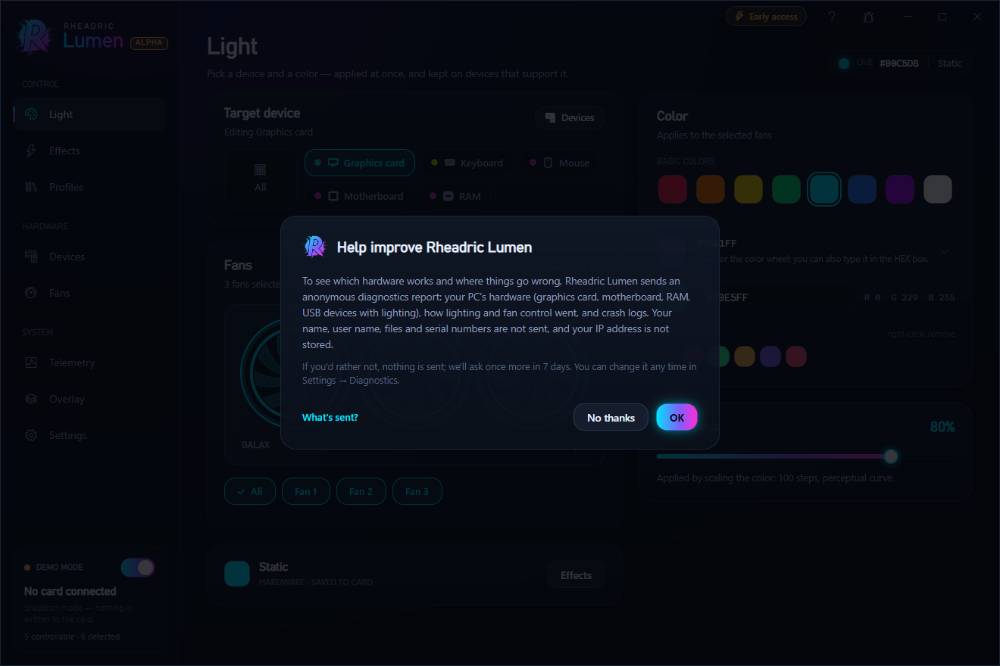 | 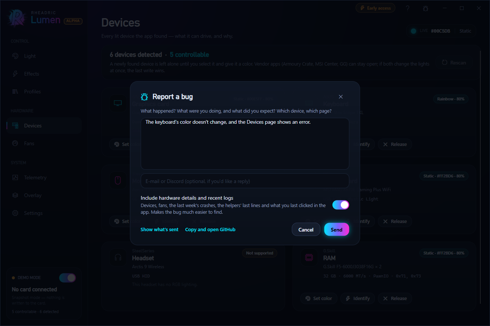 |

Other network traffic:

- **Update check**, once a day: the app asks GitHub for the latest release of this repository. Nothing about you or
  your PC goes with it; GitHub sees what any download shows it (your IP address and the app's version).
- **Downloads from GitHub**, only when you click: a new version (**Download and install**) and the PawnIO installer
  (**Install**). Both are checked against their SHA-256 before anything runs.
- SteelSeries GG's local GameSense server on your own PC (`127.0.0.1`), only when a SteelSeries device is in use.
- Razer Synapse's local Chroma SDK server on your own PC (`localhost`), only when a Razer device is plugged in.

---

## License

Free for personal use. Redistribution, resale and reverse engineering are not permitted:
see [LICENSE.txt](LICENSE.txt). Credits and third-party notices: [THIRD-PARTY-NOTICES.txt](THIRD-PARTY-NOTICES.txt).

GALAX is a trademark of GALAX (Galaxy Microsystems Ltd.). NVIDIA and GeForce are trademarks of NVIDIA Corporation.
ASUS, ROG, Aura and Armoury Crate are trademarks of ASUSTeK Computer Inc. MSI, Mystic Light and MSI Center are
trademarks of Micro-Star International. SteelSeries, GG and GameSense are trademarks of SteelSeries ApS.
G.Skill is a trademark of G.Skill International. Gigabyte, AORUS, Palit, Gainward, KFA2, EVGA, ZOTAC, Colorful, iGame,
MANLI, PNY, Corsair, iCUE, Vengeance, Dominator, Kingston, FURY, NZXT, Lian Li, Cooler Master, Thermaltake, ASRock,
Polychrome, Logitech, G HUB, Razer, Synapse, Chroma, Keychron, Intel and the other product names above are trademarks
of their owners. This project is not
affiliated with any of them.

---

<a name="turkce"></a>

<div align="center">

# Türkçe

**Bilgisayarındaki tüm ışıklar ve fanlar, tek pencereden.**

Ekran kartı, klavye, mouse, anakart ve RAM ışıkları · ekran kartı fanları, CPU fanı, pompa ve kasa fanları ·
oyunun üstünde canlı sensör ve FPS paneli. Bir yığın üretici programı yerine tek, küçük, yerel bir uygulama.

[English](#english) · **Türkçe**

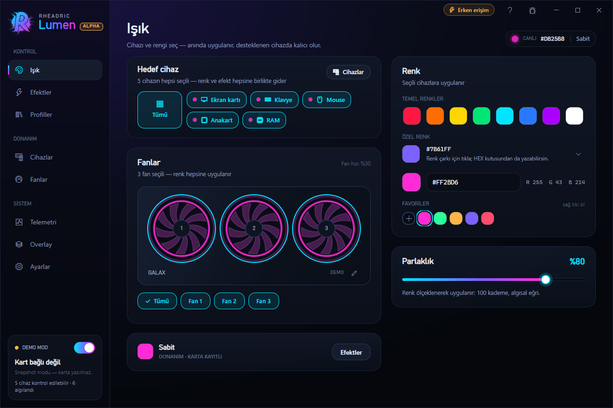

</div>

[İndir](#tr-indir) · [Gereksinimler](#tr-gereksinimler) · [Neler yapar](#tr-neler-yapar) · [Ekran görüntüleri](#tr-ekran) ·
[Desteklenen donanım](#tr-donanim) · [Kullanım](#tr-kullanim) · [Komut satırı](#tr-komut) ·
[Kaldırma](#tr-kaldirma) · [SSS](#tr-sss) · [Gizlilik](#tr-gizlilik) · [Lisans](#tr-lisans)

---

<a name="tr-indir"></a>

## İndir

**Önerilen: kurulum paketi.** Yukarıdaki yeşil **Download** düğmesi
[`Rheadric-Lumen-v2.1.1-alpha-setup.exe`](https://github.com/rheadricc/RheadricLumen/releases/download/v2.1.1-alpha/Rheadric-Lumen-v2.1.1-alpha-setup.exe)'yi
indirir. Çalıştırıp ilerle: yalnızca senin Windows kullanıcın için kurar (yönetici izni istemez),
`%LOCALAPPDATA%\Programs\Rheadric Lumen`'e; Başlat menüsüne ekler, son sayfada masaüstü kısayolu önerir ve
*Ayarlar → Uygulamalar*'a kaldırıcı koyar.

**Kurmadan, taşınabilir:** program bu reponun içinde de duruyor: `RheadricLumen.exe` ve yanındaki üç DLL (çizim motoru:
`libSkiaSharp.dll`, `libHarfBuzzSharp.dll`, `av_libglesv2.dll`). Bunları
[`Rheadric-Lumen-v2.1.1-alpha-win64.zip`](https://github.com/rheadricc/RheadricLumen/releases/download/v2.1.1-alpha/Rheadric-Lumen-v2.1.1-alpha-win64.zip) (~17.0 MB)
olarak ya da sayfanın üstündeki yeşil **`<> Code`** düğmesi → **Download ZIP** ile al. **Zip'i çıkar** (sağ tık →
*Tümünü Ayıkla…*), **Rheadric Lumen** klasörünü kalıcı bir yere taşı ve `RheadricLumen.exe`'ye çift tıkla. Dört dosyayı
birlikte tut.

İkisi de aynı program, kendini aynı şekilde günceller. Eski sürümler ve sürüm notları:
[Releases](https://github.com/rheadricc/RheadricLumen/releases).

> **SmartScreen uyarısı mı çıktı?** Exe henüz dijital olarak imzalı değil; ilk açılışta *"Windows bilgisayarınızı
> korudu"* görünür. **Ek bilgi → Yine de çalıştır**'a bas.

> **Güncelliyor musun?** 2.0.3'ten itibaren bunu uygulama kendisi yapar: günde bir kez buradaki yeni sürüme bakar,
> varsa sağ üstte yeşil bir **indirme düğmesi** çıkar. Tek tıkla indirir, doğrular ve uygulamayı yeni sürümle yeniden
> açar (**Ayarlar → Güncellemeler → Güncellemeleri denetle** hemen bakar). Daha eski bir sürümden geçiyorsan onu kapat
> (tepsi simgesi → **Çıkış**) ve yenisini aç: renkler, profiller, favoriler, fan ayarları ve "Windows ile başlat"
> taşınır. 2.0.0 ya da daha eskisinden geliyorsan arayüz Türkçe kalır.
> İlk kurulum İngilizce açılır; **Settings → Language → Türkçe** ile değiştir.

---

<a name="tr-gereksinimler"></a>

## Gereksinimler

| | |
|---|---|
| **Windows 10 ya da 11, 64 bit** | Gerekli. |
| **Uygulamanın kendisi için başka bir şey gerekmez** | Kurulum yok, .NET yok, Visual C++ paketi yok: yerel bir Windows programı. |
| **NVIDIA ekran kartı sürücüsü** | Ekran kartının ışığı, fanları ve GPU değerleri için. Güncel herhangi bir GeForce sürücüsü. |
| **[PawnIO](https://pawnio.eu)** *(ücretsiz, imzalı sürücü, isteğe bağlı)* | Yalnızca **RAM ışığı**, **anakart fanları** ve **CPU / RAM sıcaklıkları** için. Gereken bilgisayarlarda uygulama ilk açılışta kurmayı önerir (ya da **Ayarlar → PawnIO sürücüsü**): resmi kurulumu geliştiricisinin GitHub'ından indirir ve önce doğrular. Elle: [PawnIO_setup.exe](https://github.com/namazso/PawnIO.Setup/releases/latest). OpenRGB ve LibreHardwareMonitor'ın da kullandığı sürücü. |
| **SteelSeries GG** *(isteğe bağlı)* | Yalnızca SteelSeries mouse ışığı için; açık olmalı. |
| **Razer Synapse** *(isteğe bağlı)* | Yalnızca Razer ışığı için (Chroma bileşeni); açık olmalı. |

Windows **yönetici izni**ni yalnızca bir özellik gerektirdiğinde ister: Otomatik dışındaki ekran kartı fan modları ve
donanım yardımcısı (RAM ışığı, anakart fanları, CPU/RAM sıcaklıkları, FPS). Bunları kullanan bilgisayarlarda uygulama
ilk açılıştan birkaç saniye sonra **bir kez** sorar (güncellemeden sonra bir kez daha), sonra hiç sormaz: yardımcılarını
izin sormadan başlatan bir zamanlanmış görev kaydeder (**Ayarlar → Yönetici izni**, kaldırmak da oradan). Vermezsen
Windows her yardımcı başlarken sorar. Işık, profiller, efektler ve overlay izin istemez.

---

<a name="tr-neler-yapar"></a>

## Neler yapar

Bilgisayarın her parçası genelde kendi programıyla gelir: ekran kartının biri, klavyenin bir başkası, anakartın bir
üçüncüsü, fanlar da BIOS'ta. Rheadric Lumen donanımla doğrudan konuşur ve hepsini tek pencereye toplar: cihazları seç,
renk ya da efekt ver, fanları ayarla, oyundayken sensörlere göz at.

### Işık

| | |
|---|---|
| 🎨 **Bütün cihazlar bir arada** | Ekran kartı, klavye, mouse, anakart ve RAM: birini, birkaçını ya da **Tümü**'nü renklendir. Her cihaz kendi ayarını tutar; yeni bulunan bir cihaza sen renk verene kadar dokunulmaz |
| 🌈 **Renkler** | Renk çarkı, HEX girişi, 8 temel renk, özel renk yuvası ve favoriler. Parlaklık 0–100 |
| ✨ **Efektler** | **Yazılım efektleri** seçili bütün cihazlarda çalışır: Spektrum, Nabız, Ateş, Aurora, Termal, Sensör ve Müzik (duyduğuna tepki verir). Termal ve Sensör, seçtiğin değeri (GPU, CPU ya da RAM; sıcaklık ya da yük) belirlediğin aralıkta izler. **Donanım efektleri** (Sabit, Nefes, Gökkuşağı, Renk döngüsü, Anakart senkronu, Kapalı) ekran kartının kendisinde çalışır; uygulama kapalıyken ve yeniden başlattıktan sonra da kalır |
| 💾 **Profiller** | 6 hazır görünüm; kendi profillerini kaydet, üzerine yaz, sil |

### Fanlar

| | |
|---|---|
| 🌀 **Ekran kartı fanları** | Otomatik (sürücü), Sabit % ya da sürükleyerek düzenlenen sıcaklık eğrisi; canlı RPM. **0 dB**: belirlediğin sıcaklığın altında fanlar sürücüye bırakılır, onları durdurabilen tek şey o |
| 🌬️ **Anakart fanları** | CPU fanı, pompa ve her sistem fanı soketi **ayrı ayrı**: Otomatik (BIOS), Sabit % ya da CPU'yu, GPU'yu veya hangisi daha sıcaksa onu izleyen eğri. Bir fanın ayarını tek tuşla bütün kasa fanlarına kopyala; canlı RPM ve anakart sıcaklıkları |
| 🛡️ **Önce güvenlik** | GPU 85 °C / CPU 95 °C üstünde ya da sıcaklık okunamazsa %100. Kasa fanı %20'nin, CPU fanı %25'in, pompa %50'nin altına inmez. 5 sn 0 RPM okuyan fan BIOS'a döner. Otomatik'i seçince, uygulamadan çıkınca ya da uygulama çökerse bütün fanlar sürücüye / BIOS'a döner |

### Sensörler ve overlay

| | |
|---|---|
| 📈 **Telemetri** | GPU sıcaklığı, yükü, gücü, fanı, saat hızları ve VRAM; CPU yükü ve saat hızı, RAM kullanımı. CPU (AMD Ryzen) ve DDR5 sıcaklıkları, yalnızca okunur |
| 🖥️ **Sensör paneli** | Oyunun ve her pencerenin üstünde bir panel: 15 değerden istediklerini seç; satır, sütun ya da yatay / dikey şerit; şeffaflık, arka plan, boyut. **Her monitörde:** ekranı haritadan seç, 8 sabit konumdan birini kullan ya da **sürükleyip** istediğin yere bırak; kenar boşluklarına ve ortaya yapışır. Tıklamalar arkasına geçer; sıcaklıklar sınıra yaklaşınca sarı / kırmızı olur. **Ctrl+Alt+O** gösterir ve gizler |
| 🎮 **FPS** | Öndeki oyunun FPS'i, %1 düşük ve kare süresi; PresentMon'un kullandığı Windows olaylarından okunur. Sensör paneline ekle ya da kendi konumu ve görünümü olan ayrı bir **FPS paneli** olarak göster |

### Günlük kullanım

| | |
|---|---|
| ⚡ **Hızlı kontrol** | Renkler, efektler, profiller ve overlay tepsi menüsünde; **Ctrl+Alt+L** her yerden bütün ışıkları açar / kapatır; isteğe bağlı Windows ile başlatma; [komut satırı](#tr-komut) |
| 🌍 **English / Türkçe** | İlk kurulumda İngilizce açılır; **Ayarlar → Dil** bütün arayüzü, tepsi menüsü ve overlay dahil, anında değiştirir |
| ⬇️ **Güncellemeler** | Günde bir kez yeni sürüme bakar; sağ üstteki yeşil düğme tek tıkla kurar, ayarların kalır |
| 📦 **Ayarlarını taşı** | **Ayarlar → Ayarlarını taşı → Dışa aktar** renkleri, profilleri, favorileri, fan ayarlarını ve overlay'i tek dosyaya koyar; yeni bilgisayarda **İçe aktar** hepsini geri getirir |
| 🐞 **Hata bildir** | Sağ üstteki böcek simgesi neyin ters gittiğini doğrudan geliştiriciye gönderir; istersen donanım bilgisi ve son kayıtlarla |
| 🔒 **Gizli** | Hesap yok, reklam yok. Önce okuyabileceğin, istediğin zaman kapatabileceğin anonim tanılama ([Gizlilik](#tr-gizlilik)) |

---

<a name="tr-ekran"></a>

## Ekran görüntüleri

| Cihazlar | Efektler | Sensör efekti (CPU yükü) | Profiller |
|---|---|---|---|
| 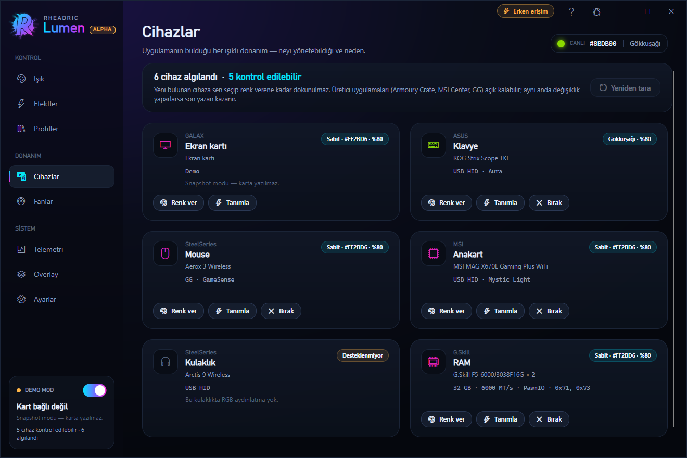 | 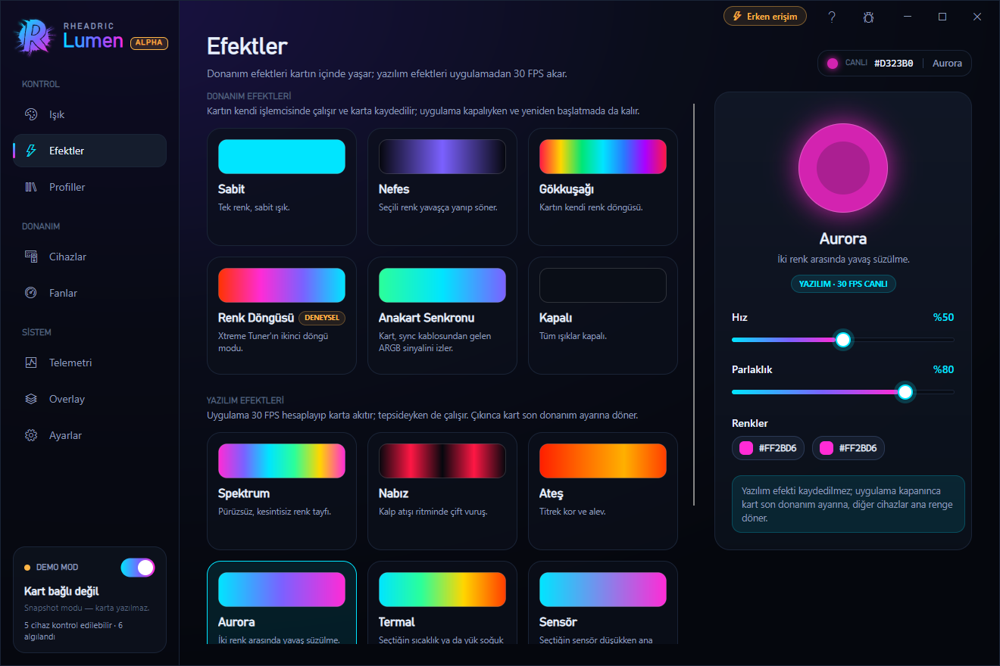 | 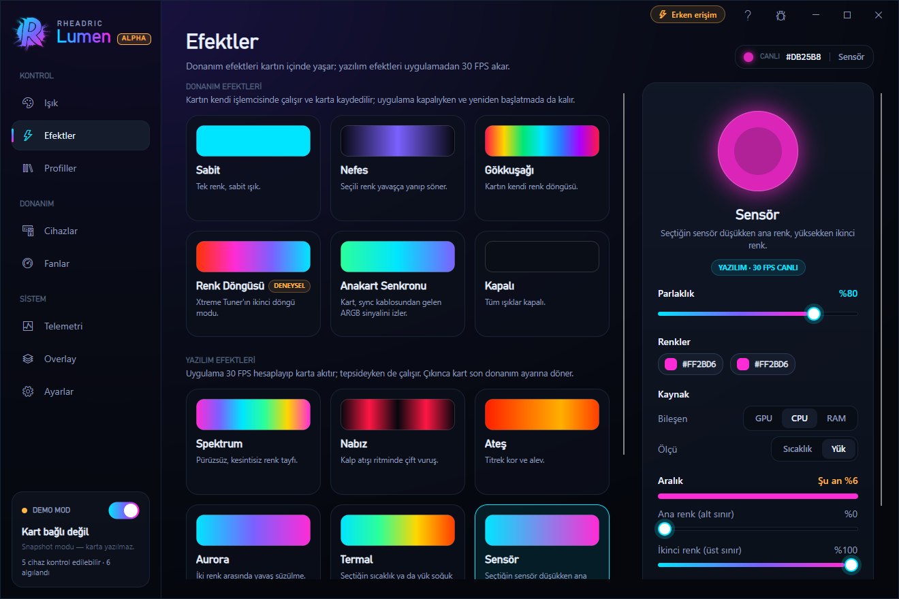 | 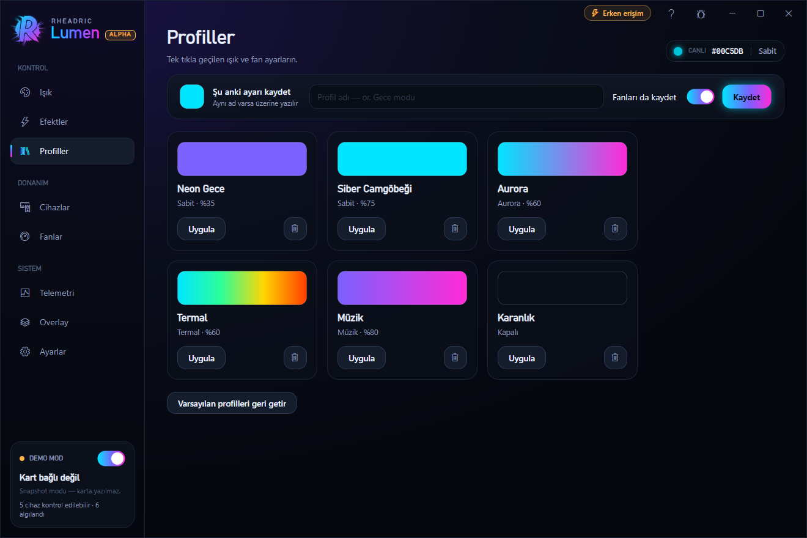 |

| Ekran kartı fan eğrisi | 0 dB | Anakart fanları | Telemetri |
|---|---|---|---|
| 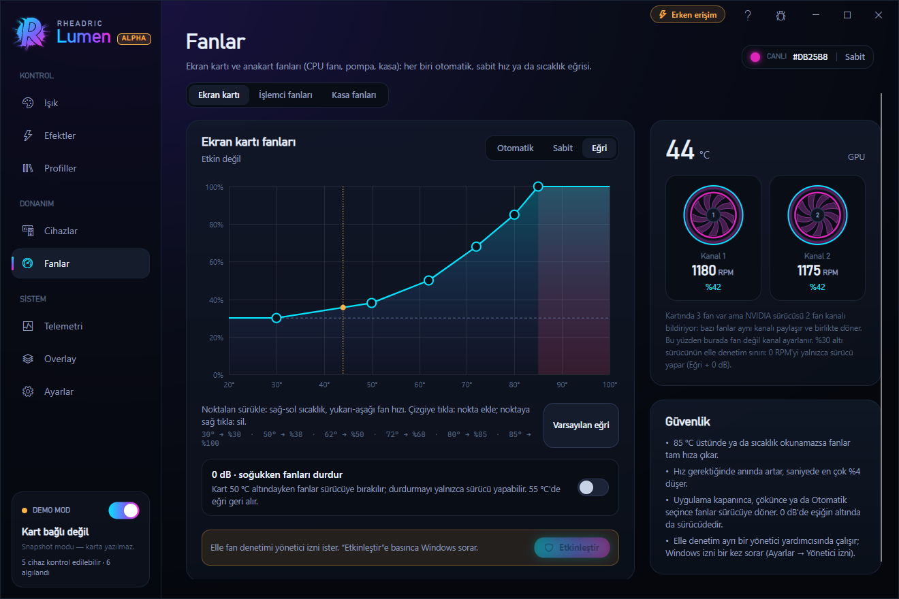 | 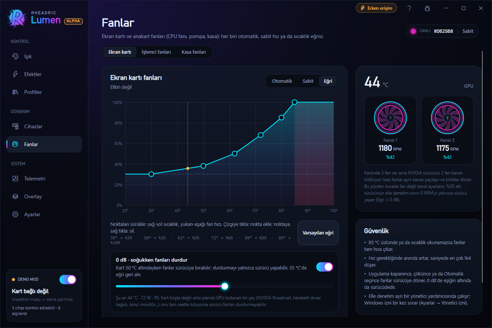 | 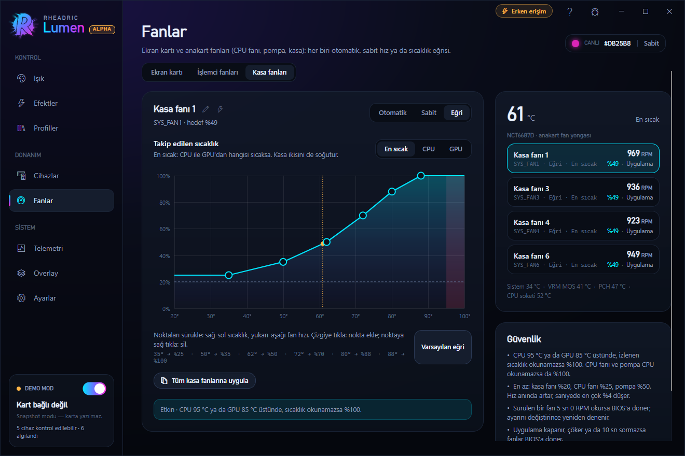 | 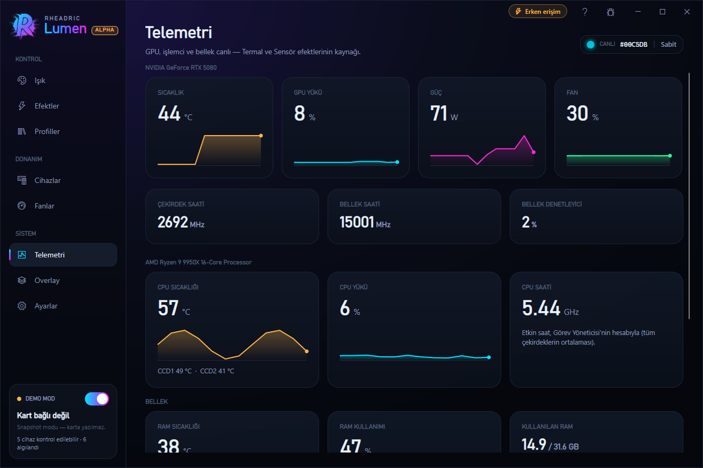 |

| Overlay ayarları | Yan ekranda serbest konum | Ekranda (şerit, arka plansız) | Ekranda (sütunlar) |
|---|---|---|---|
| 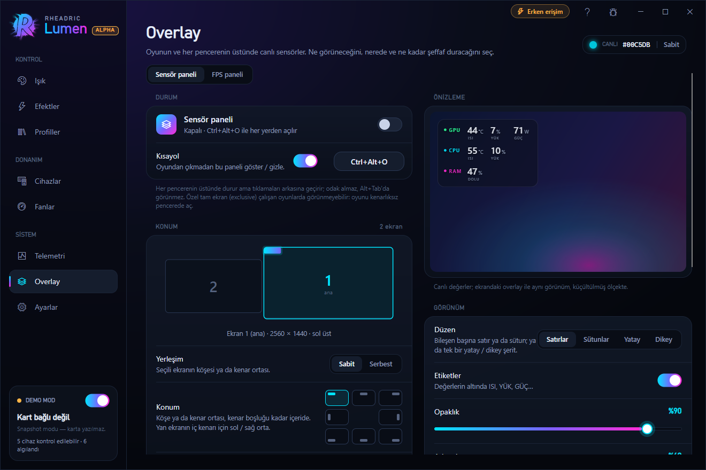 | 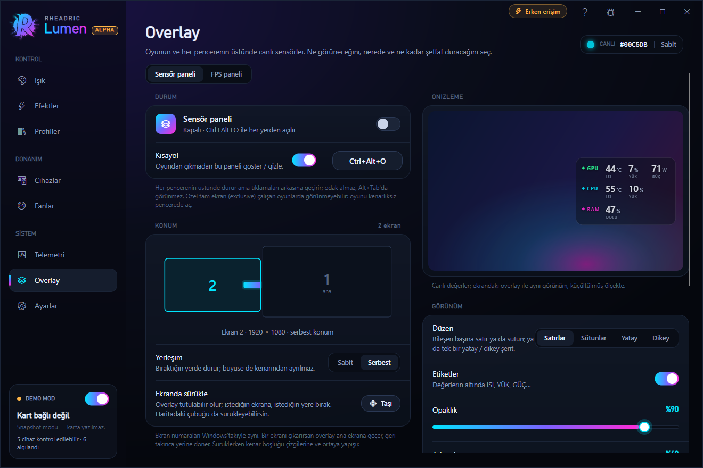 |  | 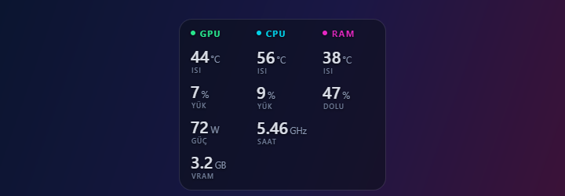 |

| FPS paneli ayarları | Ekranda FPS paneli | Dikey şerit (FPS ile) | Ayarlar ve dil |
|---|---|---|---|
| 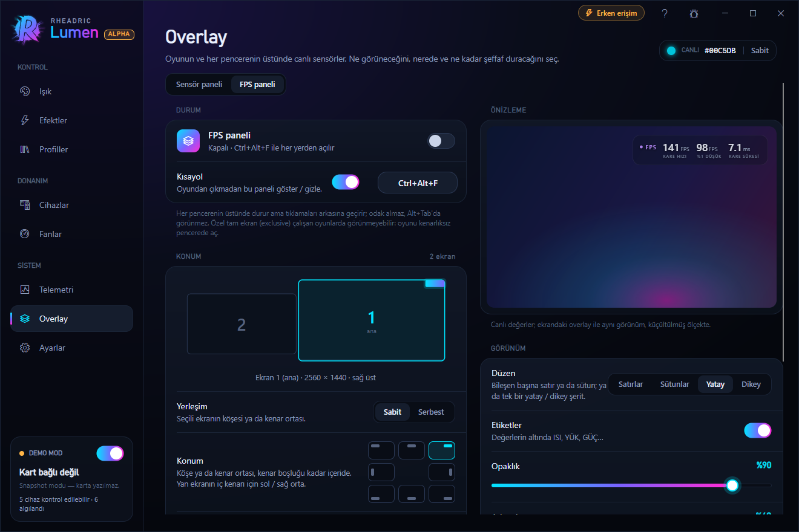 |  | 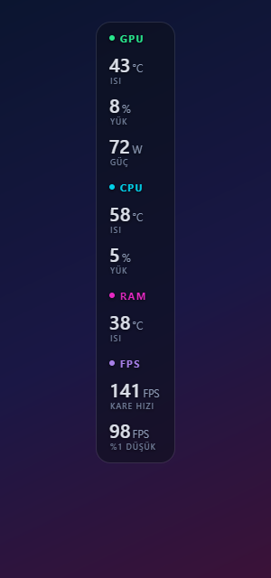 | 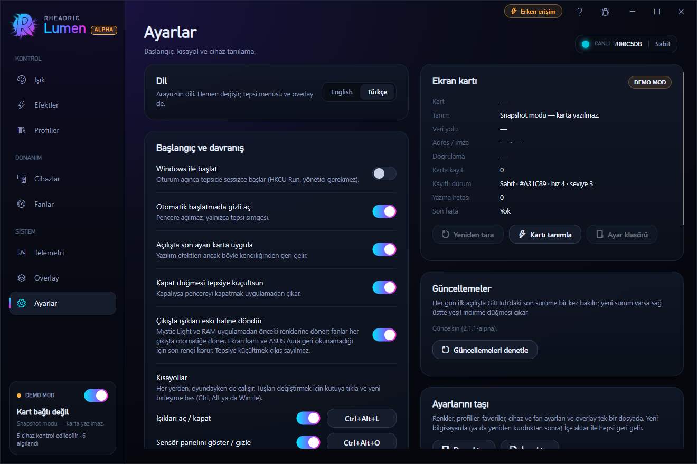 |

| Yeni sürüm | İlk açılışta PawnIO |
|---|---|
| 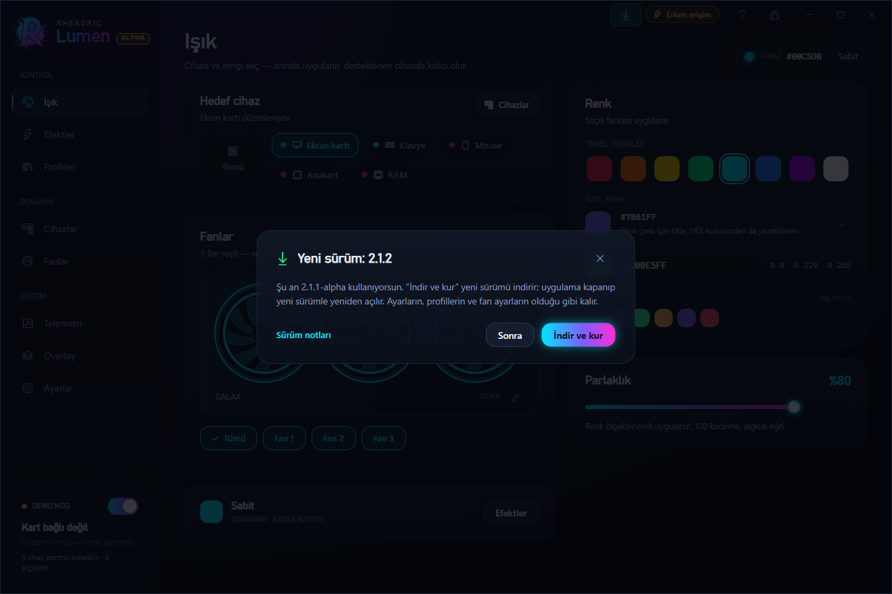 | 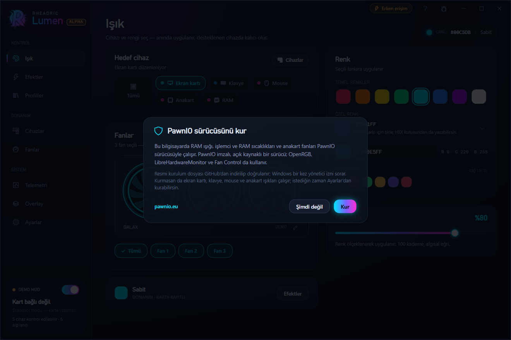 |

---

<a name="tr-donanim"></a>

## Desteklenen donanım

Aksi yazmıyorsa aşağıdakiler gerçek donanımda denendi. Sende başka bir şey mi var?
Tam model adıyla [bir issue aç](https://github.com/rheadricc/RheadricLumen/issues) ya da uygulamanın sağ üstündeki böcek simgesine bas:
*Donanım bilgisini ekle* açıkken rapor neyin bulunduğunu zaten söyler.

### Işık

| Cihaz | Nasıl | Not |
|---|---|---|
| **GALAX GeForce RTX 5080** 1-Click OC 3X | NVIDIA sürücüsü (kartın RGB denetleyicisi, I²C) | Denendi. Işık için Xtreme Tuner'a gerek kalmaz |
| **GALAX GeForce RTX 5070 Ti** EX Gamer 1-Click OC | aynı | Bilinen kimliklerden eklendi, henüz denenmedi |
| Aura denetleyicili **ASUS** ekran kartları (TUF, ROG Strix, ROG Astral, Dual…; OpenRGB'nin listelediği RTX 20–50 modelleri) | aynı (I²C `0x67`) | OpenRGB'nin protokolünden eklendi, henüz denenmedi. Kartın tüm ışıkları tek renk; tanımadığı denetleyici sürümüne dokunulmaz |
| **MSI** ekran kartları (Gaming X, Suprim, Ventus…; OpenRGB'nin listelediği RTX 20–50 modelleri) | aynı (I²C `0x68`) | OpenRGB'nin protokolünden eklendi, henüz denenmedi. Kartın tüm ışıkları tek renk |
| **Gigabyte / AORUS** ekran kartları (Gaming OC, Eagle, Aero, AORUS Master…; GTX 10'dan RTX 50'ye) | aynı (I²C) | OpenRGB'nin protokolünden eklendi, henüz denenmedi. Kartın tüm ışıkları tek renk |
| **Palit**, **Gainward** ve bazı **PNY** XLR8 ekran kartları (GameRock, JetStream, Phoenix, Phantom, Ghost…; GTX 10'dan RTX 50'ye) | aynı | OpenRGB'nin protokolünden eklendi, henüz denenmedi. Kartın tüm ışıkları tek renk |
| **EVGA** ekran kartları (FTW3, XC…; GTX 10, RTX 20 ve RTX 30) | aynı | OpenRGB'nin protokolünden eklendi, henüz denenmedi. Kartın tüm ışıkları tek renk |
| **ZOTAC GAMING** ekran kartları (Twin Fan, Trinity, AMP, AMP Extreme…; RTX 20'den RTX 50'ye) | aynı | OpenRGB'nin protokolünden eklendi, henüz denenmedi. Kartın tüm ışıkları tek renk |
| **Colorful iGame** ekran kartları (Advanced, Ultra, Vulcan, Neptune…; RTX 30'dan RTX 50'ye) | aynı | OpenRGB'nin protokolünden eklendi, henüz denenmedi. Kartın tüm ışıkları tek renk |
| **GALAX / KFA2** RTX 20 ve RTX 30 kartlar (önceki denetleyici), eski **ASUS** kartlar (GTX 10'dan RTX 30'a, ilk Aura çipi), **MANLI** RTX 4090 Gallardo | aynı | OpenRGB'nin protokolünden eklendi, henüz denenmedi. Kartın tüm ışıkları tek renk |
| **NVIDIA Founders Edition** (RTX 20'den RTX 50'ye) ve ışığını NVIDIA sürücüsünün kendisi sunan diğer kartlar (bazı Palit, Gainward, PNY EPIC-X, MANLI) | NVIDIA sürücüsü (Illumination API) | NVIDIA'nın açık API'sinden eklendi, henüz denenmedi. Sabit renk ya da kapalı; kart bunu kaydetmez, uygulama açılınca rengi yeniden yazar |
| **ASUS ROG Strix Scope TKL** klavye | USB, Aura direct modu | Denendi, tuşlar ve alt ışık. Klavyeye kalıcı bir şey kaydedilmez |
| **SteelSeries Aerox 3 Wireless** mouse | SteelSeries GG (GameSense) | Denendi. **GG açık olmalı**; uygulama kapanınca mouse GG'deki ayarına döner |
| Diğer **SteelSeries** klavyeler (Apex), mouse'lar (Rival, Sensei, Prime, Aerox) ve QcK Prism mousepad'ler | SteelSeries GG (GameSense) | Henüz denenmedi. **GG açık olmalı** |
| **Logitech G** klavye, mouse, kulaklık, mousepad, hoparlör | Logitech G HUB (LED SDK'sı) | Henüz denenmedi. **G HUB açık olmalı**; tüm Logitech G cihazları aynı rengi alır, uygulama bırakınca G HUB'daki ışığına döner |
| **QMK/VIA** klavyeler (Keychron Q, V, K Pro ve Max serileri, çoğu custom klavye) | USB, VIA'nın raw HID'i | QMK'nin VIA protokolünden eklendi, henüz denenmedi. Tuş ışıkları ve alt ışık tek renk, klavyeye kaydedilir; VIA protokolü 11 ya da sonrası gerekir |
| **Windows Dinamik Aydınlatma** destekli cihazlar (HID LampArray: birçok üreticinin klavye, mouse, kasa, şeritleri) | USB HID LampArray | Henüz denenmedi. Yukarıdaki bir satırın zaten yönettiği cihaz o satıra bırakılır. İkisi çakışmasın diye Windows Ayarları'nda *Cihazlarımda Dinamik Aydınlatmayı kullan*'ı kapatın |
| **MSI Mystic Light** anakartlar (`0DB0:0076`, ör. X670E Gaming Plus WiFi) | USB | Denendi. JRGB, JARGB ve kart üstü LED'ler; anakarta kalıcı bir şey kaydedilmez |
| 800 serisinde **MSI Mystic Light** (X870, B850, Z890…; OpenRGB'nin listelediği anakartlar) | USB | OpenRGB'nin protokolünden eklendi, henüz denenmedi. JARGB 1–3 ve JAF (EZ Conn) soketi; anakartın kendi efekti yeniden başlatınca ya da MSI Center açılınca geri gelir |
| **ASUS Aura** anakartlar (USB `0B05:1AA6`, `19AF`, `1939`, `18F3`, `1BED`; X570 ve sonrası) | USB | OpenRGB'nin protokolünden eklendi, henüz denenmedi. Kart üstü LED'ler, AURA RGB ve ARGB soketleri (onlara bağlı fanlar ve şeritler) tek renk; anakarta bir şey kaydedilmez |
| **Gigabyte RGB Fusion 2** anakartlar (USB `048D:8297`, `5702`, `5711`, `8950`, `0414:A100`) | USB | OpenRGB'nin protokolünden eklendi, henüz denenmedi. Kart üstü LED'ler ve RGB/ARGB soketleri tek renk; bir şey kaydedilmez, bilgisayar kapanıp açılınca anakartın kendi ayarı döner |
| **ASRock Polychrome** anakartlar (USB `26CE:01A2`) | USB | OpenRGB'nin protokolünden eklendi, henüz denenmedi. Denetleyicinin bildirdiği her bölge (RGB, ARGB, PCH, I/O kapağı…) tek renk |
| **NZXT** Kraken X3, Kraken Elite, RGB & Fan Controller, Smart Device V2, Hue 2 | USB | OpenRGB'nin protokolünden eklendi, henüz denenmedi. Kraken'lerin pompa hızı yalnızca sen bir hız seçersen yazılır ([Fanlar](#tr-fanlar-donanim)); denetleyicilerin fan hızına dokunulmaz. NZXT CAM açıksa kendi ışık ayarını geri yazabilir |
| **NZXT Kraken** X42, X52, X62, X72 ve M22 | USB | OpenRGB'nin protokolünden eklendi, henüz denenmedi. Logo ve halka tek renk; pompa ve fan hızına dokunulmaz |
| **Corsair** Lighting Node Pro/Core, Commander Pro, LS100, LT100, Obsidian 1000D, SPEC OMEGA RGB | USB | OpenRGB'nin protokolünden eklendi, henüz denenmedi. Renk uygulama kapanınca da denetleyicide kalır; iCUE açıksa kendi ayarını geri yazar |
| **Lian Li Uni Hub** SL, AL, SL V2, AL V2, SL Infinity | USB | OpenRGB'nin protokolünden eklendi, henüz denenmedi. Hub kanaldaki fan sayısını söylemediği için her kanal en fazla fana göre boyanır; beyaz, L-Connect'teki gibi %60'ta tutulur |
| **Cooler Master** ARGB LED denetleyicisi (`2516:1011`) | USB | OpenRGB'nin protokolünden eklendi, henüz denenmedi. Dört ARGB portu ve RGB portu; renk kutuda kalır |
| **Thermaltake** Riing, Riing Quad, Riing Trio fan hub'ları | USB | OpenRGB'nin protokolünden eklendi, henüz denenmedi. TT RGB Plus açıksa kendi ışık ayarını geri yazabilir |
| **Razer** klavye, mouse, kulaklık, mousepad | Razer Synapse (Chroma SDK) | Henüz denenmedi. **Synapse açık olmalı**; cihaz türü başına tek renk, uygulama kapanınca cihazlar Synapse'teki ışığına döner |
| ENE RGB denetleyicili **RAM** (`AUDA0-E6K5-0101`), ör. G.Skill DDR5 `F5-6400J3239G16G` | SMBus, [PawnIO](https://pawnio.eu) üzerinden | AMD'de (X670E) denendi. Bkz. [RAM ışığı](#tr-ram) |
| İlk nesil ENE denetleyicili **RAM** (`DIMM_LED-0102`, `DIMM_LED-0103`), ör. TeamGroup T-Force DDR4 | aynı | OpenRGB'nin yazmaçlarından eklendi, henüz denenmedi |
| **Corsair** RGB RAM: Vengeance RGB Pro / Pro SL / RS ve Dominator Platinum RGB (DDR4); Vengeance RGB, Vengeance RGB RS ve Dominator Platinum / Titanium RGB (DDR5) | aynı | OpenRGB'nin protokolünden eklendi, henüz denenmedi. Renkleri geri okunamadığı için **Bırak** onları bilgisayar kapanana kadar olduğu gibi bırakır. iCUE açıksa kendi ayarını geri yazar |
| **Kingston FURY** Beast / Renegade RGB RAM (DDR4 ve DDR5, parça numarası `KF…A`) | aynı | OpenRGB'nin protokolünden eklendi, henüz denenmedi. Yalnızca bütün modüller FURY RGB ise. Kingston FURY CTRL açıksa kendi ayarını geri yazar |
| **Intel** bilgisayarlarda RAM ışığı (yonga setinin i801 SMBus'ı) | aynı | Henüz denenmedi; 2.0.6'ya kadar RAM ışığı AMD yonga seti istiyordu |
| SteelSeries Arctis 9 | | Listelenir; RGB'si yok |
| Işıksız RAM (ör. Kingston FURY Beast / HyperX Fury siyah, G.Skill Ripjaws V, Corsair Vengeance LPX, Lexar THOR OC) | | Işıksız olarak listelenir; bunun için yönetici izni sorulmaz |

Ekran kartın tanınmazsa uygulama ona **hiçbir şey yazmaz**: başka üreticinin kartı kendi adıyla, ışığının
desteklenmediği notuyla listelenir. Diğer cihazlar, fanlar ve overlay yine çalışır. Klavye, mouse, anakart, sıvı soğutma ve RAM yalnızca sabit renk kabul eder; bu yüzden onlardaki hareketli
efektler uygulama tarafından kare kare çizilir ve uygulama açıkken çalışır (tepside çalışmaya devam eder).

<a name="tr-fanlar-donanim"></a>

### Fanlar

| Fanlar | Nasıl | Not |
|---|---|---|
| **Ekran kartı fanları** | NVIDIA sürücüsü | Yukarıdaki RTX 5080'de denendi |
| **Anakart fanları**: **Nuvoton NCT6687D**'li MSI 400–700 serisi anakartlarda CPU fanı, pompa, sistem fanları (ör. X570, B650, X670E) | Fan çipi, PawnIO üzerinden | X670E'de denendi. Bkz. [Anakart fanları](#tr-anakart-fanlari) |
| **NCT6687D-R**'li MSI 800 serisinde (B840, B850, X870, Z890) **anakart fanları** | aynı | LibreHardwareMonitor'ın yazmaç haritasından eklendi, henüz denenmedi |
| **Nuvoton NCT6796D–NCT6799D** ya da **NCT6701D**'li ASUS anakartlarda **anakart fanları** (ör. B850, X870E) | aynı | LibreHardwareMonitor'ın yazmaçlarından eklendi, henüz denenmedi |
| **ITE IT8686E, IT8688E, IT8689E** ya da **IT8696E**'li Gigabyte anakartlarda **anakart fanları** (ör. B450, B550, B650, X670, Z790) | aynı | LibreHardwareMonitor'ın yazmaçlarından eklendi, henüz denenmedi. Yalnızca çipin kendisinin sürdüğü soketler |
| **NZXT Kraken** X3 (X53/X63/X73) ve Kraken Elite **pompası**, Elite'in fan çıkışı | USB | liquidctl'in protokol notlarından eklendi, henüz denenmedi. **Fanlar → İşlemci fanları**: sabit hız (pompa %50–100), yalnızca sen açarsan; sıvı sıcaklığı ve pompa RPM'i |

### Sensörler

GPU değerleri NVIDIA sürücüsünden; CPU yükü, saat hızı ve RAM kullanımı Windows'tan gelir, her bilgisayarda çalışır.
CPU (AMD Ryzen) ve DDR5 modül sıcaklıkları PawnIO ister. FPS her oyunda çalışır ve yönetici izni ister.

<a name="tr-ram"></a>

### RAM ışığı

RAM ışığı anakartın SMBus hattındadır ve Windows oraya yalnızca bir çekirdek sürücüsünün erişmesine izin verir.
Rheadric Lumen kendi sürücüsünü getirmez; OpenRGB ve LibreHardwareMonitor'ın da kullandığı imzalı, açık kaynak
**[PawnIO](https://pawnio.eu)**'yu kullanır.

1. PawnIO'yu bir kez kur: uygulama ilk açılışta önerir (**Ayarlar → PawnIO sürücüsü** her zaman), ya da elle:
   [PawnIO_setup.exe](https://github.com/namazso/PawnIO.Setup/releases/latest) (geliştiricisinin GitHub'ından).
2. Rheadric Lumen'i aç, **Cihazlar**'da RAM kartındaki **Renk ver**'e bas ve bir renk seç.
3. RAM'e yazma işi, uygulamayla birlikte kapanan küçük bir yardımcı süreçte (`RheadricLumen.exe --ram-host`) yapılır.
   Bunun için bir kez verilen yönetici izni gerekir (bkz. [Gereksinimler](#tr-gereksinimler)).

Bilerek yaptıkları ve yapmadıkları:

- SMBus'a PawnIO'nun imzalı modülleriyle ulaşır: AMD yonga setlerinde `SmbusPIIX4`, Intel'de `SmbusI801`.
- Yalnızca RGB denetleyicilerine yazar. ENE (SMBus `0x70`–`0x77`): yalnızca ENE imzasıyla cevap veren ve bildiği bir
  denetleyici sürümüne sahip olanlar. Corsair (`0x58`–`0x5F`, DDR5'te ayrıca `0x18`–`0x1F`) ve Kingston FURY
  (`0x58` / `0x60` + slot) yalnızca modüllerin parça numaraları bu üreticileri gösteriyorsa aranır; sonra yalnızca
  denetleyicinin kontrolden geçtiği adresler açık kalır: Corsair'inki yalnızca okumadır (kimlik yazmaçları, ardından
  CRC'li bir bilgi bloğu, Corsair'in üretici kimliği ve bilinen bir model), Kingston'ınki "FURY" imzası ve bilinen bir
  model. Parça numarası ışıksız bir modeli gösteren kitler öyle listelenir ve hiç taranmaz; tarama denetleyici
  bulamazsa RAM kartı bunu söyler ve renk göndermeyi bırakır. Modüllerin SPD hub'ları (`0x50`–`0x57`) yalnızca
  *okunabilir*, o da yalnızca sıcaklık sensörü için gereken altı yazmaç; yardımcı onlara giden her başka işlemi reddeder.
- Her işlem MSI Center, OpenRGB ve HWiNFO'nun kullandığı sistem genelindeki SMBus kilidini alır; onlarla çakışmaz.
- Yalnızca renkleri ve doğrudan moda geçişi yazar (Kingston'da ayrıca önce okuduğu parlaklık ve slot sayısını).
  Modüllere bir şey kaydedilmez. Açılış adresi `0x77`'de kalmış ENE modülleri (açılıştan beri anakart yazılımı
  çalışmamış, dört modül tek görünür) Armoury Crate, MSI Center ve OpenRGB'nin yaptığı gibi yuvasına göre kendi adresini
  alır. Bilgisayarı tamamen kapatıp açmak kendi ışıklarını ve adreslerini geri getirir.
- **Bırak**, modüllerin uygulama onlara ilk dokunmadan önceki renklerini geri yazar; **Ayarlar → Çıkışta ışıkları eski
  haline döndür** kapalı değilse uygulamadan çıkmak da. Corsair'in renkleri okunamadığı için o modüller bilgisayar
  kapanana kadar uygulamanın rengiyle kalır.
- **MSI Center** açıksa RAM'i Mystic Light'ın senkronundan çıkar, yoksa iki program da ona yazar.

PawnIO yoksa RAM listelenir ama ona yazılmaz.

<a name="tr-anakart-fanlari"></a>

### Anakart fanları

Aynı PawnIO sürücüsü (imzalı `LpcIO` modülü) uygulamanın anakartın fan çipine ulaşmasını sağlar: MSI kartlarda
NCT6687D, ASUS kartlarda NCT679x ya da NCT6701D, Gigabyte kartlarda ITE IT868x / IT8696E.

1. **Fanlar → Anakart fanları**'nı aç. Bu, donanım sensörlerini açar (RAM'le aynı yardımcı ve aynı yönetici izni).
2. Sağdaki listeden bir fan seç (CPU fanı, pompa ya da bir kasa fanı), sonra **Otomatik** (BIOS eğrisi), **Sabit** ya
   da **Eğri** ve eğrinin hangi sıcaklığı izleyeceği. Her fan kendi ayarını tutar; tek düğme bunu bütün kasa
   fanlarına kopyalar.

- CPU fanı %25'in, pompa %50'nin altına inmez; CPU sıcaklığı okunamazsa ikisi de %100 çalışır.
- Uygulama sürerken 5 saniye 0 RPM okuyan fan, sen ayarını değiştirene kadar BIOS'a döner.
- Uygulama kapanır, çöker ya da 10 saniye boyunca istekte bulunmazsa fanlar BIOS'a döner. Yardımcının kendisi
  öldürülürse bir sonraki, her şeyden önce onları geri verir.
- Hızı değişmeyen fan PWM kontrollü değildir (3 pinli ya da bir hub üzerinde). **MSI Center**'ın, **Armoury
  Crate**'in ya da **Gigabyte Control Center**'ın fan kontrolü açıksa aynı soketler için uygulamayla çekişir: fanları
  ikisinden birinde **Otomatik**'te bırak.

---

<a name="tr-kullanim"></a>

## Kullanım

1. **Işık**: **Hedef cihaz**'da **Tümü**'nü ya da istediğin cihazları seç, sonra bir renk seç. Hemen uygulanır.
2. **Efektler**: bir animasyon ve hızını seç. Yazılım efektleri seçili bütün cihazlara gider; donanım efektleri
   ekran kartının kendisinde çalışır.
3. **Cihazlar**: bulunan her şey, neyin kontrol edilebildiği ve neden. **Renk ver** cihazı devralır, **Tanımla** onu
   yakıp söndürür, **Bırak** kendi programına geri verir, **Yeniden tara** baştan arar.
4. **Fanlar → Ekran kartı**: **Otomatik**, **Sabit** ya da **Eğri**, sonra **Etkinleştir**. Windows bir kez yönetici izni
   ister, çünkü NVIDIA sürücüsü fan hızını yalnızca yetkili bir süreçten kabul eder.
   **Fanlar → Anakart fanları**: bkz. [Anakart fanları](#tr-anakart-fanlari).
5. **Overlay**: **Sensör paneli**'ni ya da **FPS paneli**'ni aç; değerleri, düzeni ve konumu seç. Elle yerleştirmek
   için **Taşı**'ya bas, istediğin ekrana sürükle ve **Bitti** de.
6. **Profiller**: o anki görünümü bir adla kaydet, **Uygula** ile geri getir.
7. **Ayarlar → Dil**: **English** ya da **Türkçe**. Arayüz, tepsi menüsü ve overlay anında değişir.
8. Pencereyi kapatmak uygulamayı tepside bırakır. Çıkmak için: tepsi simgesi → **Çıkış**. Çıkışta fanlar otomatiğe,
   Mystic Light ve RAM eski renklerine döner (**Ayarlar → Çıkışta ışıkları eski haline döndür**).

### Bilmekte fayda var

- **Üretici programları kurulu kalabilir** (Xtreme Tuner, Armoury Crate, MSI Center, SteelSeries GG, OpenRGB); ama iki
  program aynı cihaza yazarsa son yazan kazanır. Armoury Crate profil değiştirirken kendi klavye efektini yeniden
  uygular; MSI Center açılırken kendi anakart profilini yükler.
- **GALAX kartında tek renk.** Denetleyicisi üç fanı ve yan ışığı tek renkten sürer; Fan 1/2/3 seçmek de bütün fanları
  boyar. Uygulama bu durumda haber verir.
- Penceredeki donanım animasyonu önizlemesi yaklaşıktır; kartın kendisi geri okunamaz.
- **Ekran kartı fanları, hızı uygulama verdiğinde %30'un altına inemez** (NVIDIA sınırı) ve onları yalnızca sürücü
  durdurabilir: 0 dB fanları ona bırakır, o da kart gerçekten boştayken durdurur.
- **Overlay, özel tam ekran (exclusive) oyunların üstünde görünmeyebilir**: oyunu kenarlıksız pencerede aç.
- **Windows 10'da pencere modundaki Vulkan/OpenGL oyunlarının FPS'i** görünmeyebilir: kareleri oyun değil bir sistem
  süreci sunar (PresentMon'da da aynı sınır var). Direct3D oyunları ve tam ekran oyunlar ölçülür.

---

<a name="tr-komut"></a>

## Komut satırı

```text
RheadricLumen.exe "#00E5FF" --brightness 60     sabit renk (karta kaydedilir)
RheadricLumen.exe --effect aurora --speed 30    efekt: static, breathing, rainbow, cycle, sync, off,
                                                spectrum, pulse, fire, aurora, thermal, load, audio
RheadricLumen.exe --profile "Neon Gece"         profil uygula
RheadricLumen.exe off | on | toggle             ışıkları kapat / aç / değiştir
RheadricLumen.exe --overlay on|off|toggle       sensör overlay'i (gerekirse uygulamayı tepside başlatır)
RheadricLumen.exe --sensors                     bütün sensörleri bir kez yazdır (CPU/RAM sıcaklığı yönetici izni ister)
RheadricLumen.exe --fps [saniye]                ekrana çizen her uygulamanın FPS'ini yazdır (5 sn; yönetici izni ister)
RheadricLumen.exe --lang en|tr                  yalnızca bu çalıştırmanın dili (ayar değişmez)
RheadricLumen.exe --exit                        açık uygulamayı düzgünce kapat
RheadricLumen.exe --list | --help
```

Uygulama zaten açıksa komut ona iletilir ve Işık sayfasında seçili cihazlara gider. PowerShell'de çıktıyı görmek için
sonuna `| Out-Host` ekle.

---

<a name="tr-kaldirma"></a>

## Kaldırma

Kurulum paketiyle kurduysan: *Ayarlar → Uygulamalar → Rheadric Lumen → Kaldır*. Uygulamayı kapatır; dosyalarını,
kısayolunu ve "Windows ile başlat"ı siler, yönetici yardımcısının da kaldırılmasını isteyip istemediğini sorar (Windows
o zaman izin ister). `%APPDATA%\RheadricLumen` içindeki ayarların kalır; istemiyorsan o klasörü sil. Zip'le kurduysan:

1. **Ayarlar** → **Windows ile başlat**'ı kapat.
2. Verdiysen **Ayarlar → Yönetici izni → İzni kaldır**: zamanlanmış görevi ve yardımcının
   `C:\Program Files\Rheadric Lumen` içindeki kopyasını kaldırır.
3. Tepsi simgesi → **Çıkış**. Fanlar kendiliğinden sürücüye / BIOS'a döner.
4. **Rheadric Lumen** klasörünü ve ayar klasörü `%APPDATA%\RheadricLumen`'i sil. Sonra geri isteyeceksen önce
   **Ayarlar → Ayarlarını taşı → Dışa aktar** yap.
5. PawnIO'yu yalnızca bu uygulama için kurduysan *Ayarlar → Uygulamalar*'dan diğer programlar gibi kaldır.

Uygulama kendine ait servis kurmaz; kurmasına izin verdiysen PawnIO 5. adımdaki gibi kalkar. 2. adımdan önce
uygulamayı zaten sildiysen Görev Zamanlayıcı'daki **Rheadric Lumen Helper** görevini ve `C:\Program Files\Rheadric Lumen`
klasörünü sil (yönetici olarak). Otomatik başlatma açıkken exe'yi sildiysen
`HKEY_CURRENT_USER\Software\Microsoft\Windows\CurrentVersion\Run` altındaki `RheadricLumen` değerini sil.

---

<a name="tr-sss"></a>

## SSS

**Ekran kartıma zarar verebilir mi?**
Kartın yazılımına (firmware) ya da BIOS'una dokunmaz; Xtreme Tuner'ın yazdığı RGB denetleyici yazmaçlarının aynısına
yazar. Art arda renk değişiklikleri (örneğin renk çarkını sürüklemek) kaydedilmeden önce toplanır; yazılım efektleri
karta hiç kaydedilmez.

**RAM'ime zarar verebilir mi?**
RGB programlarının RAM'e zarar verdiği bilinen yol, yanlış SMBus cihazına (SPD çipine) yazmak ya da hatta başka bir
programla yarışmaktır. RAM yardımcısı SPD aralığına hiç yazamaz, ortak SMBus kilidini alır, bir denetleyiciye ancak
onu tanıdıktan sonra yazar ve modüllere hiçbir şey kaydetmez. Bkz. [RAM ışığı](#tr-ram).

**Fan kontrolü güvenli mi?**
Güvenlik kuralları pencerede değil, yetkili yardımcı süreçlerin kendisinde çalışır: ısınınca ya da sıcaklık
okunamazsa %100, CPU fanı ve pompa için en düşük hız, yavaş iniş; Otomatik'i seçince, çıkınca ya da uygulama çökünce
yeniden sürücü / BIOS kontrolü. Kayıtlar: `%APPDATA%\RheadricLumen\fanhost.log` (ekran kartı) ve `ramhost.log` (anakart).

**Sürekli açık kalması gerekir mi?**
Yalnızca yazılım efektleri, klavye / mouse / anakart / RAM'deki hareketli efektler, Otomatik dışındaki fan modları ve
overlay için. Ekran kartındaki donanım efektleri uygulama kapanınca da kalır; RAM, klavye ve anakart bilgisayar
kapanana kadar son renklerini korur.

**Mouse'um listede yok.**
Önce SteelSeries GG'yi aç, sonra Cihazlar sayfasında **Yeniden tara**'ya bas.

**Dili nasıl değiştiririm?**
**Ayarlar → Dil → English / Türkçe** (İngilizce arayüzde **Settings → Language**). Anında değişir. İlk kurulum
İngilizce açılır.

---

<a name="tr-gizlilik"></a>

## Gizlilik

Hesap yok, reklam yok. İnternete iki tür rapor gider, ikisi de geliştiricinin kendi sunucusuna
(bir Cloudflare Worker); amaç daha çok donanımı desteklemek ve hataları bulmak:

- **Anonim tanılama.** Uygulama açıkken günde bir kez kadar: Windows sürümü, işlemci (ve nesli), bilgisayarın
  firmware'inin bildirdiği marka, model ve tip (masaüstü, dizüstü, …), anakart ve revizyonu, BIOS sürümü, yonga setinin
  SMBus ve LPC denetleyicileri, ekran kartları, RAM modülleri (marka, parça numarası, tip, boyut, hız; RAM'i uygulamaya
  verdiysen üzerlerinde hangi ışık denetleyicisini bulduğu ya da birini neden reddettiği), takılı klavye, mouse,
  kulaklık, oyun kolu ve diğer USB / Bluetooth cihazları (firmware revizyonlarıyla; üreticiye özel arabirimi olanlarda
  o arabirimin türü ve rapor boyutları) ile monitörler (cihazların bildirdiği marka ve model; senin verdiğin adlar asla),
  uygulamanın hangi ışıkları ve fanları sürebildiği ve aldığı hatalar, PawnIO sürümü, kurulu ya da çalışan diğer RGB,
  fan ya da izleme araçları (sabit bir listeden; başka program adı gitmez). Bir kilitlenmeden sonra kilitlenme kaydı. Rastgele bir kurulum kimliği aynı
  bilgisayarın raporlarını birbirine bağlar. Asla gönderilmez: adın, kullanıcı adın, bilgisayar adın, dosyaların, seri
  numaraları; kayıtlardaki klasör yolları ve e-posta adresleri silinir. IP adresin kaydedilmez. Raporlar 180 gün sonra
  silinir (kilitlenme ve hata bildirimleri 400 gün sonra).
- **Hata bildirimleri**, yalnızca hata formunda (sağ üstteki böcek simgesi) **Gönder**'e bastığında. İletişim alanı
  isteğe bağlıdır, **Donanım bilgisini ve son kayıtları ekle** kapatılabilir. Açıkken rapor, hatanın adım adım
  izlenebilmesi için uygulamadaki son adımlarını da içerir: kullandığın sayfalar, düğmeler, anahtarlar ve kaydırıcılar
  (ekrandaki adlarıyla) ve uygulamanın gösterdiği mesajlar; yazdığın hiçbir şey değil. Bunlar yalnızca bellekte tutulur,
  formdaki **Gönderilecekleri göster** hepsini gitmeden önce gösterir.

İlk açılışta uygulama bunu anlatıp sorar: **İstemiyorum** dersen hiçbir şey gönderilmez, 30 gün sonra bir kez daha
sorulur. **Ayarlar → Tanılama ve hata bildirimi** istediğin zaman açar ya da kapatır; **Gönderilecekleri göster** raporu
gideceği hâliyle gösterir.

| İlk açılış | Hata bildir |
|---|---|
| 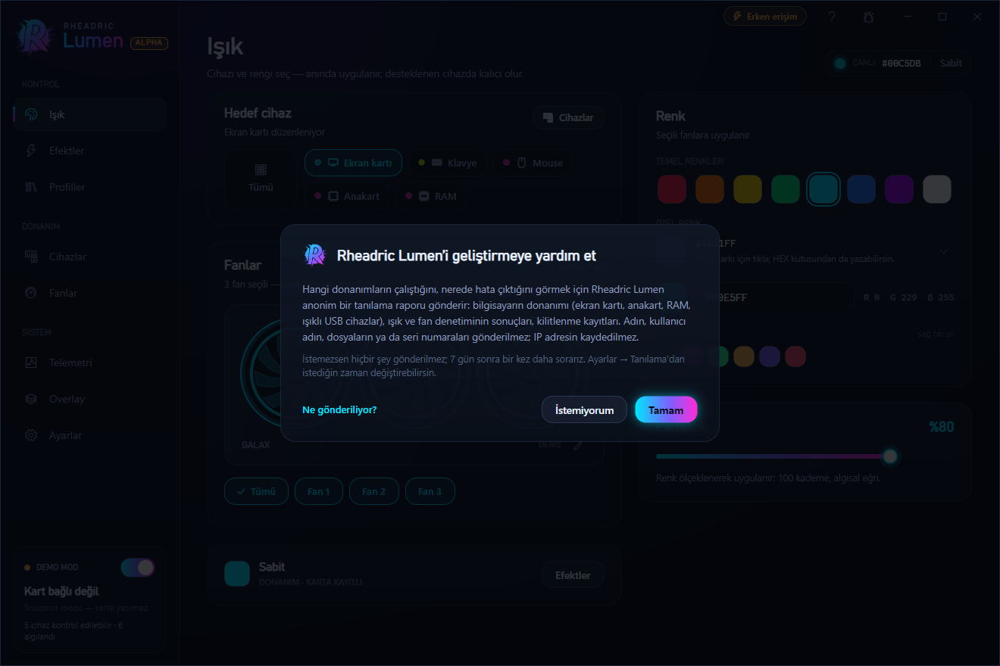 | 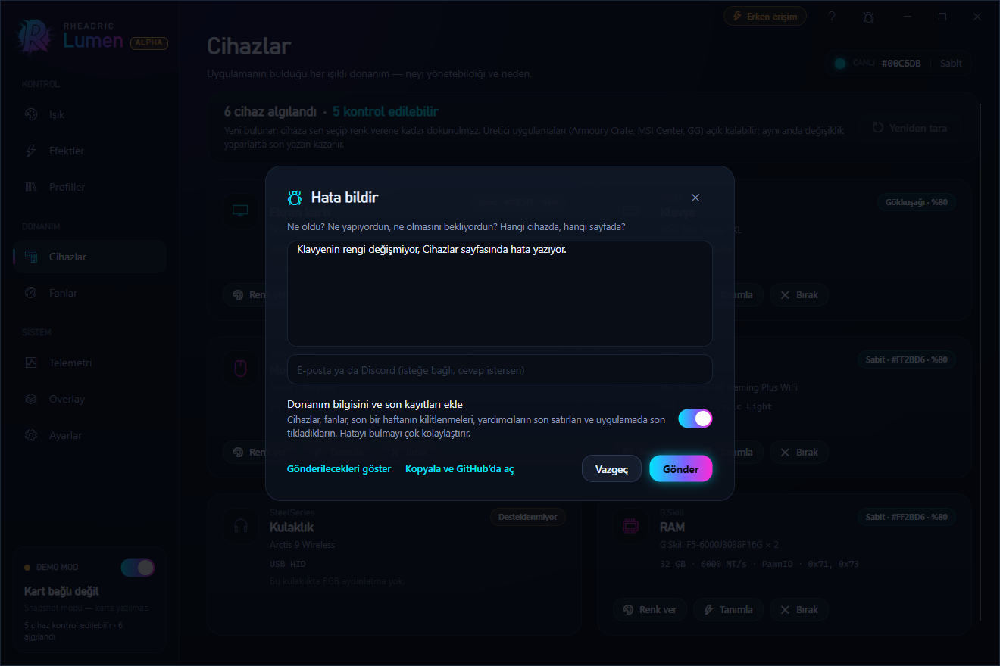 |

Diğer ağ trafiği:

- **Güncelleme denetimi**, günde bir kez: uygulama GitHub'a bu deponun son sürümünü sorar. Seninle ya da bilgisayarınla
  ilgili hiçbir şey gitmez; GitHub her indirmede gördüğünü görür (IP adresin ve uygulamanın sürümü).
- **GitHub'dan indirmeler**, yalnızca sen bastığında: yeni sürüm (**İndir ve kur**) ve PawnIO kurulumu (**Kur**).
  İkisi de çalıştırılmadan önce SHA-256 ile doğrulanır.
- SteelSeries GG'nin kendi bilgisayarındaki yerel GameSense sunucusu (`127.0.0.1`), yalnızca bir SteelSeries cihazı
  kullanılırken.
- Razer Synapse'in kendi bilgisayarındaki yerel Chroma SDK sunucusu (`localhost`), yalnızca bir Razer cihazı takılıyken.

---

<a name="tr-lisans"></a>

## Lisans

Kişisel kullanım için ücretsiz. Yeniden dağıtma, satma ve tersine mühendislik yasaktır: bkz.
[LICENSE.txt](LICENSE.txt). Katkılar ve üçüncü taraf bildirimleri: [THIRD-PARTY-NOTICES.txt](THIRD-PARTY-NOTICES.txt).

GALAX, GALAX'ın (Galaxy Microsystems Ltd.) ticari markasıdır. NVIDIA ve GeForce, NVIDIA Corporation'ın; ASUS, ROG, Aura
ve Armoury Crate, ASUSTeK Computer Inc.'in; MSI, Mystic Light ve MSI Center, Micro-Star International'ın; SteelSeries,
GG ve GameSense, SteelSeries ApS'in; G.Skill, G.Skill International'ın ticari markalarıdır. Gigabyte, AORUS, Palit,
Gainward, KFA2, EVGA, ZOTAC, Colorful, iGame, MANLI, PNY, Corsair, iCUE, Vengeance, Dominator, Kingston, FURY, NZXT,
Lian Li, Cooler Master, Thermaltake, ASRock, Polychrome, Logitech, G HUB, Razer, Synapse, Chroma, Keychron, Intel ve
yukarıdaki diğer ürün adları sahiplerinin ticari markalarıdır. Bu projenin hiçbiriyle bağlantısı yoktur.

---

© 2026 Batuhan Çakır (Rheadric)
